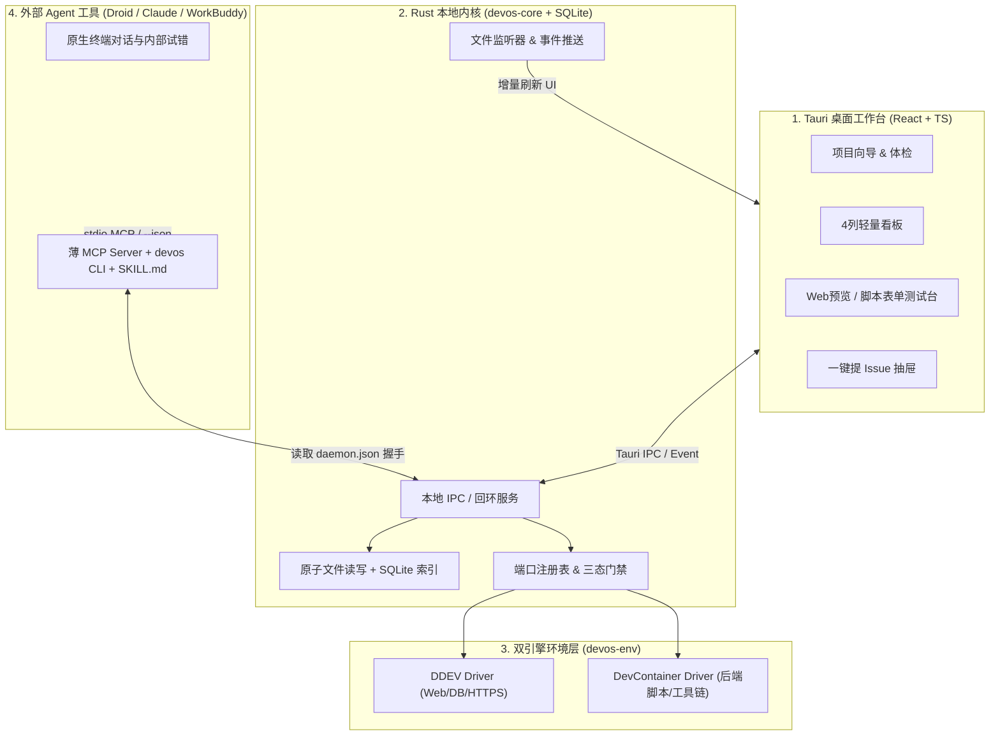
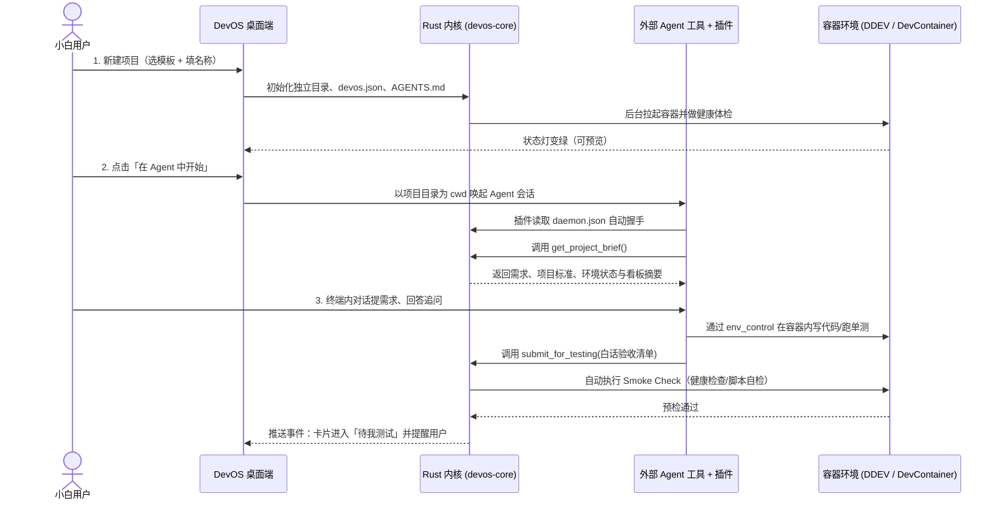
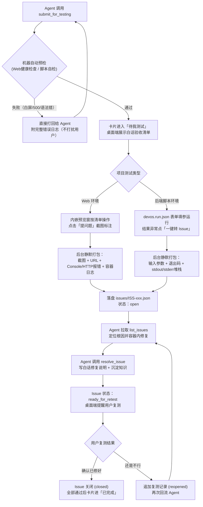
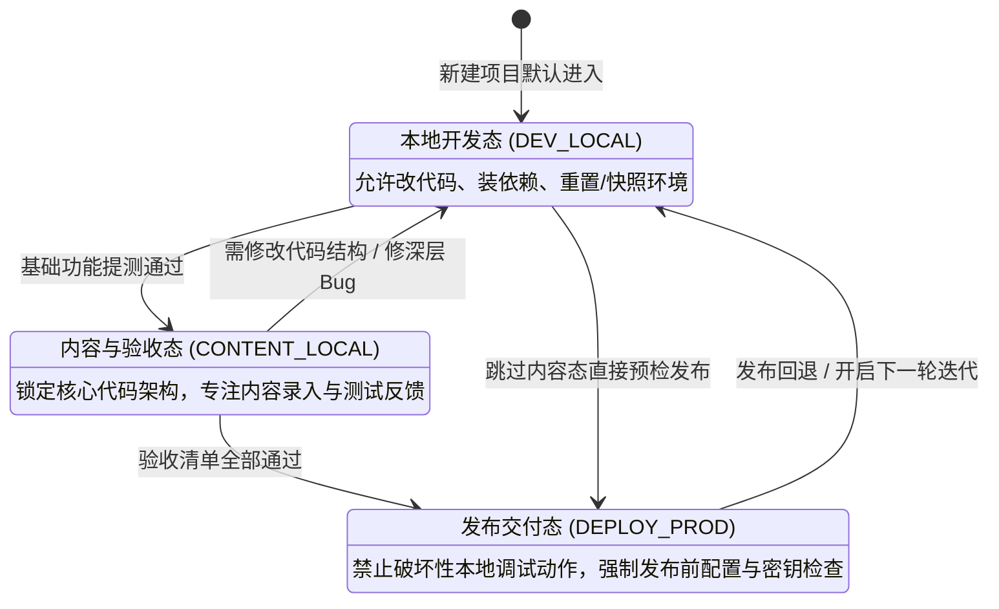

## 文档 5：核心流程图与状态机图例（`05-flows-and-diagrams.md`）

以下 Mermaid 图表可直接粘贴到 GitHub、Notion、Obsidian 或静态文档站中渲染。

### 图 1：系统分层与数据流总图

### 图 2：Agent 插件零配置握手与双端联动时序图

### 图 3：提测门禁与 Issue 解决闭环（Web + 后端脚本双通道）

### 图 4：三态模式权限与安全门禁状态图

---
