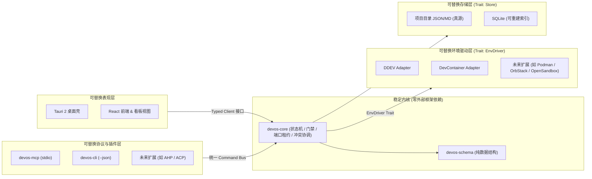

整个桌面应用（Tauri 2 + React + TypeScript）采用**固定三段式全局壳 + 6 个核心工作区视图**。下面先给出各页面的空间分区布局与关键控件，再列出 Windows、macOS、Linux 三端桌面 WebView 以及 Agent CLI 终端的界面开发避坑点。

---

## 一、 全局外壳与各核心页面布局

### 1. 全局主框架（Global Shell）

所有业务页共享这套外框，确保小白随时能看到“我在哪个项目、环境健不健康、AI 连上了没”。

| 左侧导航栏（固定 `220px`，可折叠至 `60px`） | 顶部控制条（固定高度 `52px`，全宽自适应） |
| --- | --- |
| **顶部**：应用 Logo + 「+ 新建项目」主按钮<br>

<br>**中部（项目列表）**：<br>

<br>• 项目卡片（项目名 + 绿/灰/红环境圆点）<br>

<br>• 展开当前项目的 4 个子入口：<br>

<br>  1. 看板与进度<br>

<br>  2. 测试与预览台<br>

<br>  3. Issue 反馈中心（带红点数字）<br>

<br>  4. 项目资产（需求/标准/文档/知识）<br>

<br>**底部**：<br>

<br>• 「连接 Agent 工具」入口（带已连接数量）<br>

<br>• 环境体检（Preflight Doctor）状态入口<br>

<br>• 设置 | **左侧**：当前项目名 + 三态模式胶囊标签（`本地开发中` / `验收中` / `发布态`，点击切换）<br>

<br>**中间**：环境状态灯（`Web 运行中` / `脚本就绪`）+ Agent 握手灯（`已连接：Factory Droid`）<br>

<br>**右侧动作组**：<br>

<br>• `[启动 / 停止环境]` 主按钮<br>

<br>• `[保存 / 还原状态]`（快照下拉）<br>

<br>• `[在 Agent 中打开]` 快捷按钮 |
| *（左侧栏底部固定）* | **主工作区（Fluid 自适应，独立滚动，背景浅灰 `#F7F8FA`）** |

---

### 2. 项目创建向导 & 环境体检页（Onboarding / New Project）

采用**居中分步卡片（最大宽度 `760px`）**，把 Docker/DDEV 检测前置，避免建到一半报错。

| 步骤条（顶部居中）：`1. 环境体检` $\rightarrow$ `2. 选择项目形态` $\rightarrow$ `3. 基本信息与初始化` |
| --- |
| **Step 1（环境体检卡片）**：<br>

<br>• 列表逐项展示：Docker 引擎、WSL2（仅 Windows 显示）、DDEV、Dev Container CLI。<br>

<br>• 每项右侧仅 3 种状态：`已就绪（绿勾）` / `未启动（点此一键启动）` / `未安装（白话安装指引）`。 |
| **Step 2（三选一大卡片，3 列等宽）**：<br>

<br>• **Web 站点/应用**（自动配 DDEV：含域名、HTTPS、数据库）<br>

<br>• **后端脚本/自动化**（自动配 Dev Container：Python/Node 隔离运行）<br>

<br>• **Web + 后端混合**（双引擎同时启用）<br>

<br>• 下方附可选预置模板网格（如 WordPress 站点、数据抓取脚本、空白项目）。 |
| **Step 3（初始化进度面板）**：<br>

<br>• 项目名称、一句话简介、存放路径（默认工作区自动生成）。<br>

<br>• 点击「创建」后切换为**分阶段进度条**（`1/3 创建独立目录与标准` $\rightarrow$ `2/3 初始化容器环境` $\rightarrow$ `3/3 生成 AGENTS.md`），底部提供可折叠的「查看底层日志」。<br>

<br>• 完成后主按钮变为：**「在 Agent 中开始开发」** + 次按钮 **「进入项目看板」**。 |

---

### 3. 看板与进度页（Board）

采用 Linear 风格的**紧凑 4 列横向流转视图**，单列固定宽度 `280px–320px`，超出横向滚动；点击卡片从右侧滑出详情抽屉（`420px`）。

| `待开发 (todo)` | `开发中 (doing)` | `待我测试 (testing)`（高亮淡蓝边框） | `已完成 (done)` |
| --- | --- | --- | --- |
| 卡片示例：<br>

<br>• `CARD-015`<br>

<br>• 标题：支持多币种汇总<br>

<br>• 底部：关联需求标签 | 卡片示例：<br>

<br>• `CARD-013`<br>

<br>• 标题：优化 PDF 解析速度<br>

<br>• 底部：`AI 处理中` 微标 | 卡片示例：<br>

<br>• `CARD-012`<br>

<br>• 标题：批量导出 Excel<br>

<br>• **进度条：验收清单 1/4**<br>

<br>• **底部主按钮：`去测试**` | 卡片示例：<br>

<br>• `CARD-001`<br>

<br>• 标题：基础登录页<br>

<br>• 底部：已通过验收 |

* **右侧详情抽屉（点击任意卡片滑出，不跳转页面）：** 顶部展示标题、状态切换与来源标记（`由 AI 更新` / `由我更新`）；中部展示关联的需求描述与 Agent 填写的简明进展；若处于 `待我测试`，底部直接列出白话验收清单和「跳转测试台」按钮。

---

### 4. 测试与预览台（Test & Preview）

顶部提供模式切换标签（`Web 预览` / `脚本测试`，单引擎项目仅显示对应一种）。

#### 4A. Web 预览模式（左预览 + 右验收清单）

| 预览操作条（高度 `44px`，跨左侧预览区）：`[刷新]` `[返回]` `[预览地址：[https://xxx.ddev.site](https://xxx.ddev.site)]` `[浏览器打开]`    **高亮主按钮：`[提问题 / 提 Issue]**` | 右侧验收抽屉（宽度 `320px`，可折叠） |
| --- | --- |
| **内嵌实时预览画布（占剩余宽度的 100%）**<br>

<br>• 渲染本地 DDEV 站点画面。<br>

<br>• 点击顶部「提问题」后，画布进入**框选截图模式**（半透明遮罩，鼠标拖拽框选异常区域）。<br>

<br>• 松手后弹出轻量浮窗：标题、大白话描述、预期效果 + 灰色小字提示「已自动附带截图、当前网址、2 条浏览器报错与后端日志」，点「提交 Issue」直接落盘。 | **当前验收卡片：`CARD-012 批量导出 Excel**`<br>

<br>1. `[x]` 打开列表页确认数据加载<br>

<br>2. `[ ]` 勾选 3 条发票点击右上角导出<br>

<br>3. `[ ]` 确认弹出下载并包含日期列<br>

<br>

<br>**底部固定操作区：**<br>

<br>• `[全部通过，标记完成]`（全部勾选后点亮）<br>

<br>• `[该步有问题，提 Issue]`（自动带上当前步骤编号） |

#### 4B. 后端脚本测试模式（基于 `devos.run.json` 渲染）

| 左侧脚本列表（`220px`） | 中间参数表单与运行区（自适应主区） |
| --- | --- |
| • `批量解析 PDF 发票`（选中）<br>

<br>• `同步商品库存`<br>

<br>• `数据格式自检`<br>

<br>

<br>*底部提示：由 `devos.run.json` 自动生成* | **上半区（自动渲染表单）**：<br>

<br>• 标题 + 一句话功能说明<br>

<br>• 表单项按 `inputs[]` 渲染：目录选择器（`发票所在目录`）、下拉框（`默认币种`）、开关（`严格校验税号`）、文本框（`导出文件名`）<br>

<br>• 主按钮：**`[运行测试]`**（运行中变为 `[停止运行]` + 耗时计时器）<br>

<br>---<br>

<br>**下半区（运行结果与输出）**：<br>

<br>• 状态横幅：`运行成功（耗时 1.4s）` 或 `运行失败（退出码 1）`<br>

<br>• **输出文件卡片**：列出 `expected_outputs`，支持一键打开文件 / 预览表格 / 打开所在文件夹<br>

<br>• **失败或结果不对时高亮按钮：`[一键转为 Issue]**`（弹窗仅需填一句大白话原因，后台自动附带输入参数与完整报错堆栈）<br>

<br>• 折叠区：`查看终端原始输出（stdout / stderr）` |

---

### 5. Issue 反馈中心（Issues）

采用左列表（`340px`）+ 右详情（自适应）双栏邮箱式布局，优先把 `待我复测` 置顶。

| 左侧 Issue 列表（带顶部筛选：`全部` / `待我复测` / `待修复` / `已关闭`） | 右侧 Issue 详情与复测操作区 |
| --- | --- |
| • **[待复测]** `ISS-004` 点击导出按钮没反应<br>

<br>• **[待修复]** `ISS-005` 导出的表格缺日期列<br>

<br>• **[已关闭]** `ISS-001` 首页图片加载变形 | **顶部操作栏**：<br>

<br>• 状态为 `待复测` 时，顶部高亮绿色横幅展示 **Agent 填写的白话修复说明**（`fix_summary_plain`）<br>

<br>• 三个明确按钮：**`[去复测]`** **`[确认已修好]`** **`[还是不行，打回]`**<br>

<br>• 状态为 `待修复` 时，提供 **`[复制处理指令给 AI]`**（如 `请处理 ISS-005`）<br>

<br>**主体内容**：<br>

<br>• 小白描述 + 预期效果<br>

<br>• 截图预览（带红框标注）或脚本输入参数摘要<br>

<br>**底部默认折叠手风琴**：<br>

<br>• `技术排障上下文（Console 报错 / 失败请求 / 容器日志 / 修改文件列表）` |

---

### 6. 项目资产页（Assets）与 Agent 插件连接页（Agent Connect）

* **项目资产页：** 左侧 `220px` 分类树（`项目需求` / `项目标准` / `使用文档` / `避坑知识库`），右侧为干净的 Markdown 阅读与所见即所得编辑区；顶部带「由 AI 最近更新于 XX 分钟前」提示与搜索框。
* **Agent 插件连接页：** 卡片网格列出支持的 Agent 工具（Factory Droid、Claude Code、Codex、WorkBuddy 等），每张卡片显示「检测状态（已安装/未检测到）」、「MCP 与规则配置状态」以及一个 **`[一键配置连接]`** 按钮，点完自动写入配置并跑一次连通性测试。

---

## 二、 各终端界面开发注意事项

### 1. Windows 端（Tauri 2 + WebView2）

* **窗口标题栏与控制按钮：** 使用无边框自定义标题栏（`decorations: false`）时，最小化/最大化/关闭按钮必须放在**右上角**，并预留 `138px` 宽度；顶部拖动区加 `data-tauri-drag-region`，但按钮与输入框必须显式排除拖动事件，否则点击失效。
* **WebView2 运行时与打包：** Win11 默认自带 WebView2，但部分精简版 Win10 缺失；Tauri 打包配置需选用 `embedBootstrapper` 或引导安装，防止小白双击无反应。
* **高分屏 DPI 与字体：** Windows 常见 `125%`、`150%` 缩放，布局避免写死 `px` 截断文字，改用 `rem`/Flex 弹性容器；中文字体栈优先 `"Segoe UI", "Microsoft YaHei UI", sans-serif`，避免退回宋体。
* **滚动条与路径显示：** WebView2 默认滚动条较粗且生硬，前端需统一用 CSS 美化为窄悬浮样式；表单里展示项目路径时可按 Windows 习惯显示反斜杠，但传回 Rust 落盘 `devos.json` / `devos.run.json` 前统一转为 POSIX 正斜杠。

### 2. macOS 端（Tauri 2 + WKWebView）

* **红绿灯交通灯避让：** 推荐配置 `titleBarStyle: "Overlay"` 并隐藏原生标题文本，但**左侧导航栏顶部必须预留至少 `38px` 高度或 `72px` 左侧安全区**，防止新建项目按钮与系统红黄绿关闭按钮重叠。
* **Retina 2x 截图标注坐标坑（极易踩坑）：** macOS Retina 屏 `window.devicePixelRatio` 通常为 `2`。在 Web 预览页框选异常区域保存 `annotated_region` 时，**截图像素与前端 CSS 坐标存在 2 倍差值**；务必统一按逻辑像素存储坐标并附带 `dpr` 字段，或截图前按统一比例缩放，否则回显红框会严重偏移。
* **快捷键与触控板手势：** 界面提示与快捷键监听需根据平台区分 `Cmd`（macOS）与 `Ctrl`（Win/Linux）；在 Web 预览区禁用 WKWebView 默认的「双指左右滑前进/后退」手势，防止小白在预览页横向滚动表格时误触退出当前页面。
* **本地 HTTPS 证书信任：** DDEV 依赖 `mkcert` 信任本地根证书，WKWebView 对未受信任自签名证书会直接白屏拦截；环境体检（Preflight）阶段必须检查 `mkcert -install` 状态。

### 3. Linux 端（Tauri 2 + WebKitGTK）

* **GPU 合成器黑屏与闪烁兜底：** 在部分 Ubuntu 24.04 + NVIDIA 显卡或 Wayland 环境下，WebKitGTK 开启 DMABUF 硬件加速极易出现窗口白屏、黑屏或闪烁。Rust 启动入口（`main.rs`）应在创建窗口前检测 Linux/NVIDIA 环境，必要时自动注入 `WEBKIT_DISABLE_DMABUF_RENDERER=1` 兜底。
* **Wayland 与 X11 差异：** Wayland 下部分原生窗口位置记忆、全局快捷键、窗口截图接口受限；内嵌预览页的「框选截图」建议优先在 WebView 内通过 Canvas/DOM 或 Tauri 内置截屏能力实现，不要强依赖 X11 专属截屏命令。
* **字体与系统托盘：** Linux 发行版默认中文字体不一，CSS 字体栈需包含 `"Noto Sans CJK SC", "WenQuanYi Micro Hei", sans-serif`；系统托盘依赖 `libayatana-appindicator3`，打包 `.deb` / `.AppImage` 时需在依赖清单中声明，且不要把核心功能藏在托盘菜单里。

### 4. 内嵌 Web 预览与探针注入的跨端关键点

* **不要用 `<iframe>` 嵌本地 DDEV 站点：** 很多 Web 框架（WordPress、Django、Rails、Laravel 等）默认响应头带有 `X-Frame-Options: SAMEORIGIN` 或严格 `CSP`，会导致 `<iframe>` 直接拒绝加载。
* **推荐做法：** 使用 **Tauri 2 的多 WebView（Child WebView）** 贴合在主窗口预览区矩形坐标内，并通过本地轻量反向代理（Rust `hyper`/`axum` 转发到 DDEV）在 HTML 响应末尾无侵入注入那段 100 行报错采集探针；这样既不受 `X-Frame-Options` 限制，又能跨 Win/macOS/Linux 一致地抓到浏览器 `console.error` 和 `500` 网络请求。

### 5. Agent CLI 终端侧交互注意事项

虽然不接管 Agent 会话，但你的 `devos` CLI 和 MCP 输出会直接出现在各家 Agent CLI 的终端界面里：

* **严格区分人读与机读输出：** 只要传入 `--json` 或检测到 `stdout` 不是交互式 TTY（管道/MCP 调用），必须**关闭所有 ANSI 彩色转义码、进度条动画和多余提示语**，只吐合法单行/标准 JSON，防止破坏 Agent 解析。
* **Windows 终端编码防乱码：** `devos` CLI 在 Windows PowerShell / CMD 运行时，显式强制输出 UTF-8，避免中文项目名或白话报错在 Agent 工具里变成乱码。
* **日志截断护栏：** `env_control` 和 `list_issues` 返回的 `stdout_tail` / `stderr_tail` / `backend_logs_tail` 必须做行数与字节数硬上限（例如最多最后 50 行或 4KB，并提示完整日志文件路径），防止一次构建报错吐出几万字把 Agent 的上下文窗口直接打爆。


在跨平台桌面端解决“环境缺失检测 + 自动安装 + 中国大陆网络适配”，最稳妥的工程策略是：**轻量工具私有化直下（不依赖 Homebrew/Chocolatey）、重型底座向导式半自动安装、下载源走“热更镜像清单 + 自动测速 + 代理透传”**。

---

### 一、 最值得参考的开源项目（环境体检与自动安装）

| 开源项目 | 技术栈 | 最值得借鉴的实现机制 |
| --- | --- | --- |
| **`podman-desktop/podman-desktop`** | TypeScript + Electron | **跨端 Preflight 与 Onboarding 引擎标杆**。把“检测 WSL2 / 虚拟化开关 / 容器引擎 / 提权安装 / 进度条回报”抽象成声明式步骤（Check $\rightarrow$ Fix $\rightarrow$ Verify），一步步带小白完成安装与重启检测。 |
| **`rancher-sandbox/rancher-desktop`** | TypeScript + Go | **Windows WSL2 与 macOS Lima/QEMU 托管范本**。重点看它如何在 Windows 上检测/启用 WSL2 特性、导入独立发行版，以及在 macOS/Linux 上优雅管理底层虚拟机和端口转发。 |
| **`moonrepo/proto` 与 `jdx/mise**` | **Rust** | **Rust 私有化工具链管理器标杆**。展示如何用 Rust 直接拉取 Node、Python 等官方压缩包、做 SHA256 校验、解压到独立目录并自动管理环境变量，完全不污染用户系统全局 `PATH`。 |
| **`ddev/ddev`（安装器与 `ddev debug test`）** | Go + Shell/PS1 | 参考它的跨端前置诊断逻辑（Docker 连通性、端口 80/443 占用、`mkcert` 根证书信任状态检测），可直接翻译为你的 `devos-env` 中的 `Preflight Doctor`。 |

---

### 二、 组件分层安装策略：不要指望“全靠包管理器”

新手电脑里通常没有 Homebrew（macOS）或 Scoop/Winget（Windows），且在中国大陆，Homebrew 首次安装和更新极易卡死。建议将依赖严格分为两层处理：

| 层级 | 包含组件 | 推荐安装实现方式 |
| --- | --- | --- |
| **第一层：轻量工具（DevOS 私有托管）** | `ddev`、`mkcert`、便携版 `Node.js`、`@devcontainers/cli`、便携版 `Git`（Win） | **Rust 直接下载压缩包解压至 `~/.devos/bin/**`。启动容器或命令时，由 `devos-env` 自动把 `~/.devos/bin` 拼到子进程 `PATH` 最前面。完全绕开 Homebrew/Winget，卸载干净、版本锁定、零系统污染。 |
| **第二层：重型系统底座（向导式半自动）** | Windows WSL2、Docker Desktop / OrbStack（macOS）/ Docker Engine（Linux） | 涉及系统内核、虚拟化与管理员提权（UAC / `sudo`），无法完全无感静默。采用 **“检测缺失 $\rightarrow$ 应用内断点续传下载安装包 $\rightarrow$ 唤起系统安装器 $\rightarrow$ 后台轮询直到 `docker info` 返回成功”** 的引导流。 |

*(小技巧：macOS 端检测容器引擎时，可把 **OrbStack** 作为优先推荐选项之一，体积比 Docker Desktop 小得多、冷启动快且内存占用低，对小白更友好。)*

---

### 三、 解决中国大陆网络问题的 4 层灵活架构

中国大陆的痛点不在单一环节，而是“二进制下载 + Docker 镜像拉取 + 容器内依赖安装（npm/PyPI/apt）”三处同时卡顿，且国内免费公共镜像源经常失效。因此绝对不能把某一个镜像 URL 写死在代码里。

#### 1. 远程可热更的镜像清单（`mirrors.json`）+ 2 秒自动测速

应用内置一份默认 `mirrors.json`，同时每次启动时异步从你自己的轻量静态地址（如国内对象存储 OSS/COS + GitHub 备用）拉取最新镜像表。

* **提供 4 种网络预设：** `自动测速择优（默认）` / `中国大陆加速` / `官方直连` / `使用自定义代理或镜像`。
* **并发测速（Race）：** 下载前对候选源发一个 2 秒超时的 HTTP `HEAD` 探测，自动挑最快且返回 `200` 的源；下载中途如果断连或速度低于阈值（如 `< 50KB/s` 持续 10 秒），自动无缝切换到下一个备用源。

#### 2. 代理自动继承与透传（最稳的终极解）

很多大陆用户本机其实开着代理工具，但命令行和 Docker 容器默认吃不到系统代理。

* **自动读取系统代理：** Rust 端使用 `sysproxy` 或读取环境变量（`HTTP_PROXY` / `HTTPS_PROXY` / `ALL_PROXY`），自动应用到组件下载器。
* **一键透传给容器引擎：** 在 DevOS 设置里提供「为容器环境启用代理」开关，自动把本机代理地址（注意容器内需转换为 `host.docker.internal:<port>`）注入到容器构建参数和 Docker 配置中，解决 `docker pull` 和容器内拉代码超时。

#### 3. 三处源配置联动（一次切换，全链路生效）

当用户选择「中国大陆加速」模式时，`devos-env` 自动联动配置三处：

1. **组件二进制源：** Node 走淘宝/清华/中科大镜像；`ddev`/`mkcert` 走你的国内 OSS 镜像或可配置的 GitHub 加速前缀。
2. **Docker 镜像源：** 体检阶段检测 Docker 的 `daemon.json`；若直连 `hub.docker.com` 超时，引导用户填入可用的国内镜像加速器地址（或开启代理透传），并提供「一键测试拉取 `hello-world`」验证连通性。
3. **容器内部包管理器源：** 生成 `.devcontainer/devcontainer.json` 或 `.ddev/config.yaml` 时，自动注入对应环境变量（如 `NPM_CONFIG_REGISTRY`、`PIP_INDEX_URL`、`GOPROXY`），让 Agent 在容器里装依赖不再卡死。

#### 4. 断点续传、SHA256 校验与离线导入兜底

* **防劫持校验：** 无论从哪个第三方镜像或加速站下载二进制，**SHA256 校验清单始终以官方/签名清单为准**，校验不通过立即丢弃并换源，防止镜像站投毒或下载残缺包。
* **断点续传：** Rust 使用 `reqwest` 配合 HTTP `Range` 头支持断点续传，大安装包（如 Docker Desktop 数百 MB）断网重连不用从头下。
* **离线包逃生门：** 体检界面底部留一个低调入口「已有本地安装包？点此导入」，兼容弱网或企业内网环境。

---

### 四、 可直接落地的配置与体检模型参考

在 `devos-env` 中，可以把镜像源清单设计为如下结构，方便后续热更新与用户自定义覆盖：

```json
{
  "manifest_version": "2026.11",
  "profiles": {
    "cn_accelerated": {
      "label": "中国大陆加速",
      "github_release_prefixes": [
        "https://cdn.your-devos-mirror.cn/github/",
        "https://ghfast.top/https://github.com/"
      ],
      "node_dist_mirror": "https://npmmirror.com/mirrors/node/",
      "container_env_vars": {
        "NPM_CONFIG_REGISTRY": "https://registry.npmmirror.com",
        "PIP_INDEX_URL": "https://pypi.tuna.tsinghua.edu.cn/simple",
        "GOPROXY": "https://goproxy.cn,direct"
      }
    },
    "official_direct": {
      "label": "官方直连",
      "github_release_prefixes": ["https://github.com/"],
      "node_dist_mirror": "https://nodejs.org/dist/",
      "container_env_vars": {}
    }
  },
  "artifacts": {
    "ddev": {
      "version": "v1.24.x",
      "urls_by_target": {
        "windows-x86_64": "ddev/ddev/releases/download/{{version}}/ddev_windows-amd64.{{version}}.zip",
        "macos-aarch64": "ddev/ddev/releases/download/{{version}}/ddev_macos-arm64.{{version}}.tar.gz",
        "linux-x86_64": "ddev/ddev/releases/download/{{version}}/ddev_linux-amd64.{{version}}.tar.gz"
      },
      "sha256_by_target": {
        "windows-x86_64": "...",
        "macos-aarch64": "...",
        "linux-x86_64": "..."
      }
    }
  }
}

```

**体检与安装状态机（集成在首次启动向导中）：**

1. **探测网络画像**：并发 Ping 官方源与国内镜像（超时 2 秒），自动推荐「官方直连」或「中国大陆加速」，同时允许用户手动切源或填代理。
2. **分层检测组件**：并行执行 `Preflight Check`，区分 `Ready`、`FixableAuto`（第一层轻量工具，点一下自动下到 `~/.devos/bin`）、`FixableGuided`（第二层 Docker/WSL2，提供下载+引导+轮询验证）。
3. **验证闭环**：所有项变绿后，自动跑一次极轻量的环境连通性验证（检查 `docker info` + `mkcert` 证书状态），通过即进入新建项目主流程。


这套系统横跨**三端安装包生命周期、Tauri 桌面 UI、Rust 内核、容器环境（DDEV / DevContainer）以及外部 Agent 插件**，绝不能把所有东西塞进一个巨大的端到端测试里跑——那样不仅慢，而且极易因为 Docker 拉镜像或 LLM 波动导致 CI 天天爆红。

针对**公开仓库 + GitHub Actions 免费 Runner**，最稳妥的落地方式是“分层解耦 + 双驱动切换（Mock 驱动与真实容器分离）+ 三端 Runner 扬长避短”。

---

## 一、 先说清 GitHub 免费 Runner 的真实能力边界（避坑前提）

公开仓库可以免费使用 `ubuntu-latest`、`windows-latest`、`macos-latest`，但它们对容器的支持差别很大，方案必须顺着这个物理限制来设计：

| GitHub Runner | 原生能力 | 明确限制 | 承担的测试职责 |
| --- | --- | --- | --- |
| **`ubuntu-latest`** (24.04) | 原生 Linux Docker、Xvfb 虚拟桌面、速度快 | 无 | **主力全栈战场**：真实 DDEV + 真实 `@devcontainers/cli` + 真实 MCP 闭环 + Tauri WebDriver UI 测试 + `.deb`/`.AppImage` 安装卸载 |
| **`windows-latest`** (Server 2022/2025) | 原生 WebView2、NSIS/WiX 打包 | **不支持嵌套虚拟化**，无法在标准免费 Runner 上跑 WSL2 + Linux Docker Desktop | `.exe`/`.msi` 静默安装/升级/卸载、Windows 路径/CRLF/UTF-8 兼容、WebView2 UI 测试（配合 Mock 环境驱动） |
| **`macos-latest`** (Apple Silicon) | 原生 `.dmg` 打包、代码签名校验 | 免费虚拟化节点跑完整 Linux Docker 极不稳定且慢；WKWebView 无官方 `tauri-driver` | `.dmg` 挂载安装/卸载/热更新验证、Rust 核心与插件配置测试、前端 Vitest/Playwright（配合 Mock 环境驱动） |

> 如果后续需要验证 **Windows WSL2 / macOS OrbStack 下的真实 Docker**，只需在发版前用你自己的本地电脑或 1 台低配自托管 Runner（Self-hosted Runner）跑一次发布前验收即可，日常 CI 不必和免费 Runner 的虚拟化限制死磕。

---

## 二、 五层自动化模拟测试架构

### 第 1 层：协议与内核单元测试（三端必跑，每次 PR 触发，约 3 分钟）

不启动 UI、不启动 Docker，专门把最容易出低级 Bug 的底层逻辑锁死：

* **Schema 与类型同步校验**：运行 `devos-schema` 的 `ts-rs` 导出命令后执行 `git diff --exit-code`，确保 Rust 结构体与前端 TypeScript 类型 100% 一致。
* **文件原子读写与索引重建**：并发写入 `devos.json` 和 `ISS-xxx.json`，删掉 SQLite 后验证全量重建无损。
* **三态门禁与路径安全**：专门构造 Windows 反斜杠路径、CRLF 换行符、路径穿越（`../../etc/passwd`）和 `DEPLOY_PROD` 下的危险命令，验证全部被拦截。
* **中国大陆网络与镜像降级模拟（重点）**：在 CI 里起一个本地极简 HTTP 服务（Rust `wiremock`），模拟 3 种故障场景并断言下载器行为：
1. 镜像源 1 故意延迟 3 秒超时 $\rightarrow$ 验证自动切换镜像源 2；
2. 镜像源返回被篡改的文件 $\rightarrow$ 验证 SHA256 校验失败并丢弃重试；
3. 下载到 50% 断开连接 $\rightarrow$ 验证 HTTP `Range` 断点续传成功。


---

### 第 2 层：插件与 Agent 交互模拟（无 LLM 费用、100% 确定性）

不要在每次提交时去调真实的 Claude / GPT API（贵且输出不稳定）。做法是写一个 **确定性 Mock Agent 测试桩（Test Harness）**，它本身就是一个标准 MCP Client，完全模拟外部 Agent CLI 的真实行为：

1. **插件一键配置测试（幂等性验证）**：
* 在临时隔离目录（覆盖 `HOME` / `USERPROFILE`）中预置空的或已有内容的伪造配置文件（模拟 Claude Code、Factory Droid、WorkBuddy 的配置路径）。
* 调用你的「一键安装插件」逻辑，断言 MCP 配置与 `SKILL.md` 写入正确、JSON 格式合法、**连续运行两次不会把用户原有配置写坏或重复追加**。


2. **完整 MCP 协议与 Issue 闭环回放**：
* Mock Agent 启动你的 `devos-mcp`（`stdio` 传输），读取 `daemon.json` 完成握手，按固定剧本走完一整套流程：
1. 调 `get_project_brief` $\rightarrow$ 校验返回的项目标准和环境状态；
2. 调 `submit_for_testing`（故意让脚本报错） $\rightarrow$ 断言被提测门禁**打回**，看板卡片**没有**进入 `待我测试`；
3. 修复测试桩文件后再次 `submit_for_testing` $\rightarrow$ 断言门禁通过，卡片进入 `testing` 且白话验收单落盘；
4. 模拟小白提交 `ISS-001.json` $\rightarrow$ Mock Agent 调 `list_issues` 拿到报错日志 $\rightarrow$ 调 `resolve_issue` 写白话修复说明与知识库条目 $\rightarrow$ 断言状态变为 `ready_for_retest` 且 `knowledge/` 新增文件。


*(可选补充：每周或发版前单独跑一个 `workflow_dispatch` / Nightly 任务，用 Secrets 里的低成本模型 Key 跑 1 次真实 Agent CLI，专门验证 `AGENTS.md` 和 `SKILL.md` 提示词有没有因为模型更新而失效。)*

---

### 第 3 层：真实容器环境 E2E（在 `ubuntu-latest` 上跑真 Docker）

在 `ubuntu-latest` 中利用原生 Docker，把真实环境打通测试：

* **环境准备**：CI 缓存 DDEV 和 `@devcontainers/cli` 二进制以及基础镜像层（利用 `actions/cache` 缩短耗时）。
* **Web 环境闭环（DDEV）**：用 `devos-cli` 创建极简 Web 模板（如单文件 PHP/Node 路由，带 `/health` 和一个故意报 500 的 `/fail` 接口） $\rightarrow$ `devos env up` $\rightarrow$ 验证健康检查 200 $\rightarrow$ 请求 `/fail` $\rightarrow$ 验证日志抓取拿到 500 堆栈 $\rightarrow$ 执行 `snapshot` 与 `restore` 验证回滚。
* **后端脚本环境闭环（DevContainer）**：拉起轻量 `python:3.11-slim` Dev Container $\rightarrow$ 按 `devos.run.json` 传参运行正常脚本，断言输出文件生成在 `.devos/artifacts/` $\rightarrow$ 传入非法参数触发 `exit_code: 1`，断言自动生成的 Issue 包含 `stderr_tail` 和完整入参。

---

### 第 4 层：桌面端 UI 与 Web 预览探针测试

为了兼顾速度与覆盖率，UI 测试拆成两半：

* **前端交互与状态流（Playwright，极快）**：在浏览器中运行 React 前端，Mock 掉 Tauri `invoke` 接口，全覆盖测试：新手建项向导、4 列看板拖拽与详情抽屉、`devos.run.json` 动态表单渲染、Issue 复测与打回、双语文案检查（断言主界面不出现 `stderr` / `SQLite` 等技术词）。
* **真实 Tauri 窗口 + 预览探针 E2E（`tauri-driver` + WebdriverIO，在 Linux `xvfb-run` 与 Windows 上跑）**：
* 启动编译好的真实 Tauri 应用（开启 `DEVOS_ENV_DRIVER=mock` 或指向本地轻量测试 HTTP Server）。
* 打开内嵌 Web 预览页，点击页面里故意抛 `console.error` 和 `fetch 500` 的按钮 $\rightarrow$ 点击桌面端「提问题 / 提 Issue」 $\rightarrow$ 断言 `issues/ISS-xxx.json` 里**同时存在截图文件、页面 URL、Console 报错和 500 响应片段**。


---

### 第 5 层：客户端安装、更新、卸载全生命周期测试（三端实测）

这是桌面软件最容易发版翻车的环节，必须在 GitHub Runner 上直接测**真实打出来的安装包**，而不是 `cargo run`。

#### 核心前置设计：给客户端加一个 `--smoke-test` 冒烟参数

在 Tauri 的 `main.rs` 里留一个测试入口：当以 `devos-app --smoke-test`（或环境变量 `DEVOS_SMOKE_TEST=1`）启动时，应用正常初始化窗口/WebView、初始化 SQLite、拉起本地守护进程并写入 `daemon.json`，完成自检后自动打印版本号并以退出码 `0` 退出。这样在无头 CI 里就能 100% 验证**装完的真实二进制能正常启动不崩溃**。

#### 三端安装 / 卸载测试实现

* **Windows (`windows-latest`)**：
1. **静默安装**：运行 `DevOS-Setup.exe /S`（NSIS）或 `msiexec /i DevOS.msi /qn /l*v install.log`。
2. **安装断言**：检查安装目录主程序、`devos.exe` CLI、桌面/开始菜单快捷方式是否存在；运行 `devos-app.exe --smoke-test` 确认启动正常。
3. **静默卸载**：运行 `uninstall.exe /S` 或 `msiexec /x DevOS.msi /qn`。
4. **卸载断言**：确认程序文件与快捷方式已清空，同时**断言用户创建的测试项目目录（如 `%USERPROFILE%\DevOS-Projects`）被安全保留，没有被卸载程序误删**。


* **macOS (`macos-latest`)**：
1. 挂载 `.dmg`：`hdiutil attach DevOS.dmg -nobrowse -mountpoint /Volumes/DevOS`。
2. 拷贝 `/Volumes/DevOS/DevOS.app` 到 `/Applications/`，校验 bundle 结构与可执行权限，执行 `/Applications/DevOS.app/Contents/MacOS/devos-app --smoke-test`。
3. 卸载镜像并删除 `.app`，验证清理干净。


* **Linux (`ubuntu-latest`)**：
1. `.deb` 测试：`sudo dpkg -i devos_*.deb`（如有缺失依赖则测 `apt-get install -f`） $\rightarrow$ `xvfb-run devos-app --smoke-test` $\rightarrow$ `sudo apt-get remove -y devos`。
2. `.AppImage` 测试：`chmod +x` 后配合 `--appimage-extract-and-run` 在 `xvfb-run` 下跑冒烟验证。


#### 自动更新（Auto-Update）全链路模拟测试

Tauri 2 内置 `tauri-plugin-updater`，在 CI 里可以 100% 离线闭环测试“旧版本 $\rightarrow$ 新版本”升级，且不污染线上发布：

1. 在 CI 中生成一对临时测试用签名密钥（`tauri signer generate`）。
2. 编译两个极简测试包：**`v0.0.1`**（旧版）和 **`v0.0.2`**（新版，并用测试私钥签名）。
3. 在 CI 本地起一个静态 HTTP 服务（`[http://127.0.0.1:18080/latest.json](http://127.0.0.1:18080/latest.json)`），托管 `v0.0.2` 的更新清单与安装包。
4. 安装并启动 `v0.0.1`，在 `~/.devos` 写入一份旧版 SQLite/项目数据，通过环境变量 `DEVOS_UPDATER_ENDPOINT=[http://127.0.0.1:18080/latest.json](http://127.0.0.1:18080/latest.json)` 触发自动检查并执行更新。
5. 更新完成后重新运行 `--smoke-test`，断言：
* 输出版本号已变为 `0.0.2`；
* 之前写入的旧版项目数据与 SQLite 索引完好无损且完成了自动迁移。


---

## 三、 GitHub Actions 流水线触发编排（兼顾效率与全面性）

| Workflow 文件 | 触发时机 | 运行内容 | 预计耗时 |
| --- | --- | --- | --- |
| `ci-fast.yml` | 每次 Push / PR | **第 1 层**（三端 Rust 单测 + Schema/TS 同步 + 网络镜像降级模拟）+ **第 2 层**（Mock Agent MCP 闭环 + 插件注入）+ 前端 Playwright | 5～8 分钟 |
| `ci-env-e2e.yml` | 合并到 `main` / 涉及 `devos-env` 改动 | **第 3 层**（`ubuntu-latest` 真实 DDEV + DevContainer 闭环）+ **第 4 层**（Linux/Win `tauri-driver` 预览探针 E2E） | 12～18 分钟 |
| `ci-release-lifecycle.yml` | 打 Tag（`v*`）/ 手动触发 / 每晚定时 | **第 5 层**（Win/macOS/Linux 三端真实打包装包 $\rightarrow$ 静默安装 $\rightarrow$ 冒烟启动 $\rightarrow$ `v0.0.1` 到 `v0.0.2` 自动更新 $\rightarrow$ 卸载保留用户数据） | 20～30 分钟 |
| `ci-real-agent-nightly.yml` | 手动触发 / 每周定时 | 使用真实 Agent CLI 跑 1 次最小项目梳理与修 Issue，验证 `SKILL.md` / `AGENTS.md` 提示词有效性 | 5 分钟 |

---

## 四、 架构上只需预留 3 个小口子，就能让上述测试极易实现

为了避免后期为了写测试大改代码，从写第一行代码开始就在 Rust 内核里留好这 3 个依赖注入点：

1. **`EnvDriver` 可切换**：支持通过环境变量 `DEVOS_ENV_DRIVER=mock` 切到内存模拟驱动，让 Windows/macOS 免费 Runner 也能流畅跑完整套 UI 和 MCP 流程。
2. **所有外部端点可覆盖**：镜像清单地址（`DEVOS_MIRROR_MANIFEST_URL`）、自动更新地址（`DEVOS_UPDATER_ENDPOINT`）、用户数据根目录（`DEVOS_HOME`）全部支持环境变量覆盖，CI 里永远指向本地 Mock Server 和临时目录，互不干扰。
3. **内置 `--smoke-test` 探针模式**：让安装、更新测试在没有显示器、没有人工点击的 GitHub Runner 里，也能确凿地证明客户端二进制、SQLite、WebView 和守护进程全部健康启动。


**完全可以实现，而且“应用自动扫描本机已安装的 Agent 工具 $\rightarrow$ 列表展示状态 $\rightarrow$ 由用户手动点击安装/更新插件”是目前最稳妥、最符合安全合规与小白体验的做法。**

可行性的底层原因很明确：当前国内外主流 Agent CLI 和 IDE 虽然各自路径与格式不同，但几乎都收敛到了“本地配置文件（JSON / JSONC / TOML）+ `skills/*/SKILL.md` + `hooks`”**或**“原生 CLI 注册命令”（如 `claude mcp add`、`qoder mcp add`）。你的 Rust 桌面端只需实现一个轻量适配器层（Adapter Registry），即可完成无损扫描与按需注入。

---

## 一、最值得直接参考的开源项目（扫描 + 跨 Agent 安装）

以下开源项目专门解决“探测本机安装了哪些 Agent 工具，并自动按各自格式写入 MCP / Skills / Hooks”的问题，可直接拆解其适配表与合并写入逻辑：

| 开源项目 | 核心能力 | 最值得你借鉴的设计 |
| --- | --- | --- |
| **`neon-solutions/add-mcp`** (`npx add-mcp`) | 探测本机/项目中的 **25+ 种 Agent 与 IDE**（含 Claude Code、Codex、Factory Droid、OpenCode、Kimi Code、Cursor、VS Code、Windsurf 等）并写入对应 MCP 配置。 | **最直接的格式转换参考**：优雅处理了不同工具的格式差异（JSON / JSONC / TOML）、根键名差异（`mcpServers` vs `servers` vs `mcp`），以及针对不同工具写入审批白名单（`--approve-tool`）的逻辑。 |
| **`dariocurr/shaic`** | 扫描本机所有已装 Agent 的配置（`discover`），将统一的 Skills、Rules、MCP 定义同步到多款 Agent，并支持漂移检测（`status`）与预览（`--dry-run`）。 | **“单一权威源 $\rightarrow$ 多工具分发”架构**：非常适合你的 DevOS 场景——维护一份标准插件包，同步到多款 Agent 时自动检测版本漂移并提示用户“插件有更新”。 |
| **`jkitchin/knowhow`** & **`agentwik-labs/skillhawk`** | 统一安装并管理 Skills、Slash Commands、Hooks 和 MCP Server，支持跨平台目标转换与安全校验。 | 参考它如何把 **MCP + `SKILL.md` + Hooks** 打包成一个逻辑单元同时安装，以及卸载时的干净清理逻辑。 |
| **Agent Plugins 1.0 规范** | VS Code / Copilot CLI 等生态推进的跨工具插件包标准（`plugin.json` + `skills/` + `mcp.json`），国内如 Qoder CLI 也采用了极相似的 `.qoder-plugin/plugin.json` 结构。 | 你的 `plugins/` 目录可直接按此标准布局打包，未来能兼容越来越多支持原生插件目录的 Agent 工具。 |

---

## 二、独立架构文档：`07-agent-adapter-and-plugin-guide.md`

以下内容可直接作为仓库 `docs/07-agent-adapter-and-plugin-guide.md` 落盘，补齐之前缺失的国内外 Agent 插件适配规范。

### 1. 国内外主流 Agent 工具适配矩阵

适配器层（建议放在 `crates/devos-core/src/adapters/`）按声明式配置维护下表，支持随 `mirrors.json` 一同热更新，避免工具改路径就必须发桌面端大版本。

#### A. 中国大陆主流 Agent 工具

| 工具名称 | 本机扫描探测信号 | MCP 配置文件路径（全局 / 项目） | Skills / Hooks / 插件目录 | 用户手动安装实现方式 |
| --- | --- | --- | --- | --- |
| **腾讯 CodeBuddy Code / WorkBuddy** | 检测 `codebuddy` 命令、`~/.codebuddy/`（Win: `%USERPROFILE%\.codebuddy`）或环境变量 `CODEBUDDY_CONFIG_DIR` | 全局：`~/.codebuddy/.mcp.json` | `~/.codebuddy/skills/`；支持原生插件与 Hooks | **自动合并写入**：向 `.mcp.json` 注入 `devos` 条目，并将 `devos` Skill 写入 `skills/`；注意兼容 `CODEBUDDY_CONFIG_DIR` 避免与多实例冲突。 |
| **字节 TRAE（国内版 / 国际版）** | 检测安装目录（macOS `/Applications/TRAE.app`、Win 注册表/`%LOCALAPPDATA%`）及 `~/.trae/` | 项目：`.trae/mcp.json`（需用户在设置开启项目级 MCP 开关）<br>

<br>全局：通过 IDE 设置页添加 | Skills：`~/.trae/skills/`、`.trae/skills/` 或共享 `.agents/skills/`<br>

<br>Hooks：`~/.trae/hooks.json`、`.trae/hooks.json`（亦兼容 Claude Hooks） | **混合模式**：项目级直接写入 `.trae/mcp.json` 与 `.agents/skills/`；全局提供「一键复制配置 JSON + 3 步图文引导」引导用户在 TRAE 设置里粘贴确认。 |
| **阿里 Qoder CLI / IDE** | 检测 `qoder` 命令及 `~/.qoder/` | 全局：`~/.qoder/settings.json`（`mcpServers` 键）<br>

<br>项目：`.qoder/settings.json` 或 `.qoder/settings.local.json` | 原生插件目录 `.qoder-plugin/plugin.json`（含 `skills/`、`hooks/`、`mcpServers`） | **优先调原生 CLI / 插件包**：调用 `qoder mcp add` 或合并写入 `settings.json`，并可选写入 `alwaysAllow` 放行只读工具。 |
| **Kimi Code** | 检测 `kimi` / `kimi-code` 命令及 `~/.kimi-code/`（或 `$KIMI_CODE_HOME`） | 全局：`~/.kimi-code/mcp.json`<br>

<br>项目：`.kimi-code/mcp.json` | 遵循项目级 `AGENTS.md` 与通用 `.agents/skills/` | **自动合并写入**：标准 JSON `mcpServers` 注入。 |

#### B. 国外主流 Agent 工具

| 工具名称 | 本机扫描探测信号 | MCP 配置文件路径与格式特点 | Skills / Rules / Hooks | 用户手动安装实现方式 |
| --- | --- | --- | --- | --- |
| **Claude Code** | 检测 `claude` 命令及 `~/.claude/`、`~/.claude.json` | 全局：`~/.claude.json`<br>

<br>项目：`.mcp.json`（JSON，`mcpServers`） | `CLAUDE.md`、`.claude/skills/*/SKILL.md`、`.claude/settings.local.json`（Hooks & 权限） | **优先调 `claude mcp add-json**` 或无损合并 JSON；同步注册 `SessionStart` 轻 Hook 提醒拉取 Brief。 |
| **OpenAI Codex CLI** | 检测 `codex` 命令及 `~/.codex/` | 全局：`~/.codex/config.toml`<br>

<br>项目：`.codex/config.toml`（**TOML 格式**） | `AGENTS.md`、`~/.codex/skills/` / `.codex/skills/` | 使用 Rust **`toml_edit`** 保留原注释无损插入 `[mcp_servers.devos]` 节点，并按需写单工具 `approval_mode`。 |
| **Factory Droid** | 检测 `droid` 命令及 `~/.factory/` | 全局：`~/.factory/mcp.json`<br>

<br>项目：`.factory/mcp.json` | `AGENTS.md`、Skills 与 Hooks | **自动合并写入**：向 `mcp.json` 注入 `devos` 服务并同步项目规则。 |
| **OpenCode** | 检测 `opencode` 命令及 `~/.config/opencode/` | 全局：`~/.config/opencode/opencode.json(c)`<br>

<br>项目：`opencode.json(c)`（**根键为 `mcp`，命令为数组**） | `AGENTS.md`、`~/.config/opencode/` / `.opencode/` | 专用格式适配器写入 `mcp.devos`（含 `type` 与 `command` 数组），兼容带注释 JSONC。 |
| **Cursor / VS Code / Windsurf** | 检测桌面应用路径及 `~/.cursor/`、`~/.codeium/windsurf/` | Cursor：`~/.cursor/mcp.json`<br>

<br>VS Code：`.vscode/mcp.json`（**根键为 `servers**`）<br>

<br>Windsurf：`~/.codeium/windsurf/mcp_config.json`（仅全局） | `.cursor/rules/*.mdc`、`.agents/skills/`（VS Code 原生读取） | 自动合并写入对应 JSON，遇到仅支持全局的客户端自动隐藏“项目级安装”开关。 |

---

### 2. 本机扫描探测引擎设计（Agent Scanner）

在 DevOS 桌面端的「连接 Agent 工具」页面，扫描过程必须**只读、毫秒级、零侵入**：

1. **三层探测策略（按优先级）：**
* **CLI 探测**：在用户登录 Shell 的 `PATH` 以及常见私有安装路径（如 `~/.local/bin`、`%LOCALAPPDATA%\codebuddy\bin`、`~/.npm-global/bin`）查找可执行文件，不直接盲目执行未知二进制，仅在命中后轻量调用 `--version`。
* **配置目录探测**：检查各工具标准配置目录（如 `~/.claude`、`~/.codebuddy`、`~/.qoder`、`~/.trae`、`~/.factory`、`~/.codex`）是否存在。
* **桌面端探测**：macOS 扫描 `/Applications/*.app`；Windows 扫描卸载注册表与 `%LOCALAPPDATA%\Programs\`；Linux 扫描 `.desktop` 文件。


2. **输出 4 种清晰状态给小白：**
* `已安装 · 未连接`（显示主按钮：**「安装 DevOS 插件」**）
* `已连接 · 正常`（检测到配置中已存在 `devos` 且指向当前 `devos-mcp` 路径与最新版本，显示 **「测试连接」/「卸载插件」**）
* `已连接 · 需更新`（插件版本低于当前 DevOS 版本，或 `devos-mcp` 路径已失效，显示 **「一键更新」**）
* `未检测到`（折叠在页面底部，附带“如果装在自定义路径，可手动指定目录”入口）


---

### 3. 用户手动安装与卸载的安全机制（绝不弄坏用户原有配置）

由用户手动点按钮触发安装时，Rust 适配器层必须严格执行以下 5 步安全流水线：

1. **变更前备份（Backup First）：** 写入任何外部配置文件前，先拷贝一份带时间戳的备份到 `~/.devos/backups/<agent>/<filename>.bak`（每个工具保留最近 5 份），出问题可一键还原。
2. **非破坏性局部合并（Surgical Merge）：**
* 绝不整文件覆盖！只读取原文件并精准增删/更新名为 `devos` 的 MCP 服务节点。
* 对 TOML（Codex）使用 `toml_edit` 保留用户原有注释与排版；对 JSONC（OpenCode / VS Code）先做注释保留解析或安全合并，严禁破坏用户已配好的其他 MCP。


3. **全局 vs. 项目级作用域分工（最佳实践）：**
* **全局安装（推荐默认）**：把 `devos-mcp` 注册到工具的全局配置中。这样用户在 DevOS 里建 10 个项目，都不需要重复装插件；`devos-mcp` 启动时自动按当前工作目录（`cwd`）向上查找 `devos.json` 动态绑定项目。
* **项目级资产（自动生成）**：建项目时，DevOS 在项目根目录同步生成 `AGENTS.md` 以及通用 `.agents/skills/devos/SKILL.md`（VS Code、TRAE、Codex、OpenCode 等越来越多工具已开始共用 `.agents/skills/` 约定）。


4. **安装后即时自检（Post-Install Verify）：** 写入完成后，DevOS 后台直接拉起一次 `devos-mcp --self-check`，验证二进制可执行权限、握手文件可读性以及目标配置文件语法校验无误，再把卡片状态切为绿色「已连接」。
5. **一键干净卸载：** 用户点「断开/卸载插件」时，精确移除配置文件中的 `devos` 节点以及 `devos` 专属 Skill 文件夹，不动用户的任何其他配置。

---

### 4. 权限最小化与“免打扰”配置约定

国内外工具（如 Claude Code、Codex、Qoder、WorkBuddy）对 MCP 工具均有审批策略：

* **只读与常规同步工具默认放行：** 适配器在支持白名单的工具（如 Qoder 的 `alwaysAllow`、Claude Code 的 `settings.local.json`、Codex 的 `approval_mode`）中，可由用户勾选是否自动放行 `get_project_brief`、`list_issues`、`update_board_card`、`sync_project_assets`，减少小白被反复弹窗打断。
* **环境执行与破坏性动作保留门禁：** `env_control` 中的破坏性子动作（`restore`/`down`）和 `DEPLOY_PROD` 相关操作不放进自动白名单，由 Agent 工具审批与 DevOS 本地三态门禁双重兜底。

---

### 5. 针对无法直接写全局配置的工具的兜底交互

少数桌面端 IDE（例如部分版本的 TRAE 全局 MCP 或封闭式桌面端）可能把全局配置存放在加密数据库或仅允许 UI 手动添加。针对这类工具，适配器声明 `install_mode: "guided_manual"`，用户点击「安装插件」时弹出一个极简 3 步引导窗：

1. 显示已生成好的标准 JSON 配置块 + 「一键复制配置」按钮（路径已自动填好本机 `devos-mcp` 的绝对路径）；
2. 给出 2 行大白话指引（例如“打开 TRAE $\rightarrow$ 设置 $\rightarrow$ MCP $\rightarrow$ 手动添加 $\rightarrow$ 粘贴确认”）；
3. 底部放一个 「我已粘贴，检测连接」按钮，验证通过即完成接入。


围绕**免登录纯本地运行、贴合主流 Agent 客户端习惯、GitHub Releases 自动更新、分层日志与全链路多语言**，下面直接从真实用户操作路径拆解设计方案，可作为仓库的 `docs/08-ux-logging-update-i18n.md` 落地规范。

---

## 一、免登录与贴合主流 Agent 客户端的 UI / UE 设计

### 1. “零登录”带来的极简首屏体验

因为不需要账号体系，应用彻底砍掉登录弹窗、注册引导、云端同步冲突和右上角头像菜单，把空间留给核心工作流：

* **打开即用**：首次启动直接进入「环境体检 + 新建首个项目」；后续启动自动恢复上次打开的项目和所在标签页。
* **左下角替代原“用户头像区”**：放「环境体检灯」、「Agent 连接状态」、「设置与版本更新徽章」，符合 Claude Desktop、Cursor、TRAE、WorkBuddy 等主流客户端的视觉重心习惯。

### 2. 复用主流 Agent 客户端的 5 个操作习惯

低开发基础用户一旦用过 Claude Desktop、Cursor、TRAE 或 Cherry Studio，已经形成了固定的肌肉记忆，本应用直接对齐这些交互范式以降低学习成本：

| 习惯维度 | 主流 Agent 客户端范式 | DevOS 对应落地设计 |
| --- | --- | --- |
| **视觉质感** | 极简中性灰（Zinc/Slate）+ 1 个主强调色、1px 细边框、默认跟随系统深色/浅色模式 | 原生支持 System / Light / Dark 三态切换，避免花哨渐变和高饱和色块，突出红/绿/黄状态灯。 |
| **侧边栏结构** | 左侧可折叠导航（`220px`）+ 顶部主新建按钮 + 底部工具与设置 | 顶部固定「+ 新建项目」，中部放项目列表与 4 个视图入口，底部固定「连接 Agent」「环境体检」「设置」。 |
| **快捷命令面板** | `Cmd/Ctrl + K` 全局唤起搜索与动作 | 支持一键切换项目、启停当前环境、跳转到某条 Issue、打开预览或复制 AI 修复指令。 |
| **非打断式详情** | 列表项点击后从右侧滑出抽屉（Slide-over），不破坏当前视图上下文 | 看板卡片详情、Issue 详情、环境底层日志全部用右侧抽屉或底部折叠栏承载。 |
| **上下文复制即用** | 提供显眼的「Copy」按钮方便跨工具粘贴 | 跨应用衔接是最大摩擦点：任何 Issue、环境报错、提测打回都自带**一键复制大白话指令**按钮。 |

### 3. 关键节点的交互提示（Micro-copy 与引导体系）

不接管 Agent 会话时，**交互提示的核心使命是消除“不知道现在该等、该点哪里、还是该切回 Agent”的迷茫感**：

* **跨工具交接提示（最关键）**：
* 小白提完 Issue 后，底部 Toast 弹出并停留 6 秒：`已打包报错与截图（ISS-004）。点击「复制指令」去 [Factory Droid] 粘贴即可让 AI 修复`，并直接附带一个 `[复制指令]` 按钮（复制内容如：`请通过 devos 处理 ISS-004`）。
* Agent 调用 `submit_for_testing` 后，触发系统原生桌面通知（OS Notification）：`「发票自动整理工具」有新功能待你验收`，点击通知直接拉起窗口并定位到测试台。


* **空状态行动引导（Empty States）**：
* 严禁展示“暂无数据”白板。例如 Issue 列表为空时显示：`太棒了，当前没有待处理问题。` + 按钮 `[去测试台验收功能]`；未连接任何 Agent 时显示：`还未连接 AI 工具，连上后 AI 才能自动帮你开发和修 Bug` + `[扫描本机 AI 工具]`。


* **长耗时阶段反馈**：
* 启动容器或拉取镜像超过 1 秒时，必须用**分步状态条**替代死转圈（例如：`1/3 检查容器引擎 -> 2/3 启动数据库 -> 3/3 预览地址已就绪`），若超过 20 秒自动提示：`首次初始化需要下载运行环境，请耐心等待（点击查看进度）`。


* **危险操作人话兜底**：
* 还原快照或删除项目时，弹窗用两句话讲清后果：`还原后将覆盖当前测试数据，但不会删除你的项目需求和文档`，确认按钮用具体动词（如 `[确认还原状态]`）而不是模糊的 `[确定]`。


---

## 二、面向小白与排障并重的三层日志系统

把日志严格分成“给人看的动态”、“给 AI/排障看的运行日志”、“给开发者定位客户端 Bug 的诊断日志”三层，绝不把原始滚动黑框堆在主界面：

| 日志层级 | 目标受众 | 存储与保留策略 | 界面呈现与核心交互 |
| --- | --- | --- | --- |
| **1. 业务动态流（Activity Log）** | 小白用户 | 存在项目 SQLite `activity_events` 表，随项目留存 | 展示在项目概览/右侧动态栏，全大白话时间线（如 `14:20 AI 提交了「导出功能」待测试`、`14:25 你提交了问题 ISS-004`），点击可直接跳到对应卡片或 Issue。 |
| **2. 环境与脚本运行日志** | 小白按需查看 + Agent 自动抓取 | 实时流存于内存环形缓冲，同时写入 `<project>/.devos/logs/env.log`（按 10MB 轮转） | 默认折叠在测试台底部或环境状态抽屉中。提供 **`仅看错误 (Error Only)`** 开关、关键词搜索，以及高亮按钮 **`[一键让 AI 诊断报错]`**（自动截取最后 50 行生成诊断指令或环境 Issue）。 |
| **3. 应用自身诊断日志** | 客户端排障 / GitHub 提 Bug | Rust 使用 `tracing` + `tracing-appender` 按天滚动写入 `~/.devos/logs/app.YYYY-MM-DD.log`，自动清理超过 7 天或超 50MB 的旧日志 | 不在主界面露面，放在「设置 $\rightarrow$ 诊断与日志」中。记录 Tauri IPC、MCP 握手、镜像测速、更新器与环境体检过程。 |

### 一键“脱敏诊断包”导出

在「设置 $\rightarrow$ 帮助与反馈」提供 **`[导出诊断包 (.zip)]`** 按钮：

* 自动打包最近 3 天的应用诊断日志 + 系统基础信息（OS 版本、CPU 架构、Docker/DDEV 版本） + 环境体检报告。
* **强制自动脱敏**：正则替换本地用户名路径（转为 `<USER_HOME>`）、移除代理密码、API Token 与 `.env` 内容，方便用户直接把压缩包拖进 GitHub Issue 反馈客户端问题而不泄露隐私。

---

## 三、基于 GitHub Releases 的应用自动更新设计

利用 Tauri 2 官方 **`tauri-plugin-updater`** 对接公开仓库的 GitHub Releases，同时兼顾中国大陆网络环境与更新安全性。

### 1. 发布与清单机制

* GitHub Actions 发版流水线构建 Win（`.nsis.zip` / `.msi`）、macOS（`.app.tar.gz`）、Linux（`.AppImage.tar.gz`）安装包，并使用 Tauri 私钥生成 `.sig` 签名文件。
* 自动生成标准的 `latest.json` 上传至 GitHub Release 附件（默认地址：`[https://github.com/](https://github.com/)<owner>/<repo>/releases/latest/download/latest.json`）。

### 2. 中国大陆网络加速与灵活回退

直连 `github.com` 和 `objects.githubusercontent.com` 在中国大陆极易超时，更新器不能写死单一官方地址：

* **动态端点拼接**：复用此前设计的 `mirrors.json` 网络画像。若用户处于「中国大陆加速」模式，更新器优先请求加速镜像前缀下的 `latest.json` 与安装包，失败则自动回退到 GitHub 官方直连或读取系统代理（`HTTP_PROXY` / `HTTPS_PROXY`）。
* **签名防篡改底线**：无论安装包从哪个第三方加速源下载，`tauri-plugin-updater` 都会用内置在客户端二进制里的**官方公钥**强制校验 `.sig` 签名，镜像站哪怕篡改 1 个字节也会直接拒绝安装。

### 3. 不打扰用户的更新交互流

1. **静默后台检查**：应用启动 5 秒后异步检查一次，并在「设置」里支持手动点「检查更新」。
2. **轻量提示而非强弹窗**：发现新版本时，仅在左侧栏底部版本号旁亮起小蓝点（`有新版本 v0.2.0`）；点击后打开精简更新弹窗，展示**对应当前语言的更新日志**与 `[后台下载更新]` / `[稍后再说]`。
3. **重启前安全校验与安抚**：下载校验完成后提示 `[立即重启更新]`。如果检测到当前正在执行 `devos.run.json` 脚本或环境初始化，提示「请等待当前任务完成再重启」；如果只是 DDEV/容器在运行，则明确告知用户「更新重启应用不会关闭你正在运行的本地预览环境，放心更新」。

---

## 四、应用程序全链路多语言（i18n）设计

这套应用是多端协作的，如果只给 React 界面做翻译，会出现“界面是中文，Rust 报错吐英文，或者英文界面下 AI 写的验收单全是中文”的割裂感。必须按 **4 层全链路** 落地：

### 1. 前端界面层（React + `i18next`）

* 使用 `i18next` + `react-i18next`，首期内置 `zh-CN`（简体中文）与 `en-US`（英文），后续社区可直接提 PR 扩展语言包。
* 按业务模块拆分命名空间，避免单文件臃肿：`common.json`、`onboarding.json`、`board.json`、`test_preview.json`、`issues.json`、`errors.json`。
* 首次启动自动读取操作系统语言（命中中文用 `zh-CN`，其余默认 `en-US`），设置页支持**热切换语言，无需重启应用**。

### 2. Rust 后端与错误提示层（只传错误码，不写死自然语言）

* **核心铁律**：`devos-core` 和 `devos-env` **禁止向前端返回写死的中/英文文案**。
* 所有业务错误与体检项统一返回结构化数据：
```json
{
  "code": "ENV_PORT_CONFLICT",
  "params": { "port": 8080, "project": "invoice-helper" }
}

```


* 前端根据 `code` 查 `errors.json` 并用 `params` 插值渲染给用户；只有给 Agent 排障用的底层技术字段（如 `raw_stderr`、`hint`）保留英文以保证各家模型理解准确度最高。

### 3. 人机协议与 Agent 输出语言联动

* **协议键名与枚举全英文**：`devos.json`、`devos.run.json`、`issues/ISS-xxx.json` 的 JSON 字段名和状态枚举（`todo` / `doing` / `testing` / `done`）永远固定英文，前端渲染时再做本地化映射。
* **把用户语言注入给 Agent**：`get_project_brief` 的返回值和生成的 `AGENTS.md` 中显式带上 `"user_locale": "zh-CN"`（随用户设置同步更新），并约定规则：
> 所有面向人类阅读的字段（`summary_plain`、`test_checklist`、`fix_summary_plain`、`devos.run.json` 中的 `label/description`、`requirements/`、`docs/`、`knowledge/`）必须使用 `user_locale` 指定的语言编写。


### 4. GitHub 更新日志与 UI 排版防爆规范

* **多语言更新日志**：`latest.json` 的 `notes` 字段可采用按语言标记的约定格式或附带双语摘要，客户端按当前语言截取对应段落展示。
* **防文本溢出铁律**：英文文案平均比中文长 30%～50%，德语/俄语更长。开发前端组件时严格遵守：
* 按钮、标签页、看板列头禁止写死固定宽度（`w-[80px]`），统一使用最小宽度 + 弹性内边距（`min-w-fit px-3`）；
* 侧边栏项目名与卡片标题统一加 `truncate` + 悬停 Tooltip，防止长单词撑破三段式布局。


针对 Tauri 2 + Rust 桌面应用的体量特点，最易维护的发布与更新策略不是“全做热更新”，也不是“改一行镜像地址就发一次客户端大版本”，而是「双轨制更新 + 目录三权分立」：**核心客户端走完整签名包原子替换，易变的网络源/Agent 适配表/模板走独立热更新，且安装目录与用户数据彻底物理隔离。**

以下内容可直接作为仓库的 `docs/09-release-perf-compat.md` 落地规范。

---

## 一、版本发布与更新架构（可维护性与无损保留设计）

### 1. 为什么采用“双轨制”而不是纯模块热更新？

Tauri 2 打包后的完整客户端通常只有 **10–25 MB**（远小于 Electron 的 150 MB+）。对客户端核心做增量补丁（Delta Patch）或动态加载二进制模块，会大幅增加跨平台签名校验、杀毒软件误报和半残状态的维护成本，收益极低。正确的拆分方式是按**变更频率**分两条轨道：

| 更新轨道 | 包含内容 | 发布与更新方式 | 核心优势 |
| --- | --- | --- | --- |
| **轨道 A：核心本体（完整包原子替换）** | Tauri 桌面端、`devos-core`、`devos-env`、`devos` CLI、`devos-mcp`、前端 UI | 通过 **GitHub Releases** 发布完整签名安装包；客户端经 `tauri-plugin-updater` 下载并**完整替换旧程序文件** | 100% 原子替换，绝不会出现“前端新、Rust 旧”的版本错配；统一走官方公钥签名校验，安全可靠。 |
| **轨道 B：易变资产（应用内热更新）** | 1. `mirrors.json`（国内镜像源清单）<br>

<br>2. `agent-adapters.json`（国内外 Agent 路径与配置格式）<br>

<br>3. 项目模板与 `SKILL.md` / `AGENTS.md` 模板<br>

<br>4. 托管工具链（`~/.devos/bin/` 下的 `ddev`/`mkcert`/`node`） | 托管在轻量静态清单仓库/OSS（附 SHA256 校验）；应用启动时异步拉取文本清单；工具链仅在用户点击「更新环境组件」时按需下载替换 | 国内某个镜像站挂了、或 TRAE/WorkBuddy 改了配置路径时，**10 分钟推送一份 JSON 即可全网修复**，不用发客户端大版本。 |

---

### 2. 如何确保“替换旧文件时 100% 保留原配置与数据”？

核心铁律是**物理目录三权分立**——安装器与卸载器只允许碰第 1 类目录，严禁触碰第 2、3 类目录：

| 目录层级 | 典型路径 | 存放内容 | 更新/卸载时的处理策略 |
| --- | --- | --- | --- |
| **1. 程序安装目录（无状态）** | Win: `%LOCALAPPDATA%\DevOS\`<br>

<br>macOS: `/Applications/DevOS.app`<br>

<br>Linux: `/usr/bin/` 或 `.AppImage` | 主程序二进制、内置静态前端资源、默认兜底清单 | **更新时整体覆盖替换，卸载时清空**。严禁往此目录写入任何用户配置或日志。 |
| **2. 应用数据目录（`DEVOS_HOME`）** | `~/.devos/`（支持环境变量覆盖） | `settings.json`（语言/代理/主题）、`index.sqlite`（全局索引）、`bin/`（托管工具与 CLI）、`backups/`（Agent 配置备份）、`logs/` | **更新时原样保留**；卸载时默认保留（仅在卸载向导提供未勾选的“同时清理缓存”选项）。 |
| **3. 用户项目工作区** | 默认 `~/DevOS-Projects/`（用户可自选） | 每个项目的代码、`devos.json`、`board/`、`issues/`、`docs/`、`knowledge/` | **永久受保护**，安装/更新/卸载全过程绝不删除。 |

### 3. 更新时的 3 个关键工程细节（防断连、防数据损坏）

1. **保持 `devos` CLI 与 `devos-mcp` 路径永久不变（防止 Agent 插件断连）：**
* 外部 Agent 工具（Claude Code、Codex、WorkBuddy 等）的配置文件里写死了 `devos-mcp` 的绝对路径。如果更新后程序路径变了，所有已装插件都会失效。
* **解法**：所有 Agent 插件统一指向固定稳定路径 `~/.devos/bin/devos-mcp`（Win 下为 `.exe`）。客户端每次更新重启时，检查安装包内嵌的 `devos-mcp` 版本是否高于 `~/.devos/bin/` 中的副本，若有更新则做原子替换（Windows 若遇文件占用，先将旧文件重命名为 `.old` 再写入新文件，下次启动清理 `.old`）。


2. **前向兼容的配置与索引迁移：**
* `settings.json` 和 `devos.json` 顶部带 `schema_version`，由 `devos-core` 启动时自动执行单向迁移（`v1 -> v2`），迁移前先自动拷贝一份 `.bak`。
* `index.sqlite` 定位为**可丢弃缓存**：如果跨大版本更新导致表结构变化，直接删除旧 SQLite 并从项目目录的 JSON/Markdown 文件在 1 秒内全量重建，彻底消除数据库迁移失败导致应用打不开的风险。


3. **跨平台安装器行为统一：**
* **Windows**：优先使用 **NSIS 静默覆盖安装**（每用户安装到 `%LOCALAPPDATA%`，避免每次更新弹 UAC 管理员弹窗吓到小白），安装前自动检测并优雅退出旧版进程。
* **macOS**：`.app.tar.gz` 解压原子替换 `/Applications/DevOS.app` 并自动重启。
* **Linux**：优先主推 `.AppImage`（支持 `tauri-plugin-updater` 原地替换更新），`.deb` 用户则通过检测新版本后提示一键下载覆盖安装。


---

## 二、应用程序性能优化设计

用户电脑上同时跑着 Docker 容器和 Agent CLI，内存与 CPU 已经很吃紧。DevOS 自身必须做到“存在感极低”（目标：**静默驻留内存 < 80 MB、CPU < 1%**）。

### 1. 文件监听（File Watcher）性能红线

* **最大性能坑**：如果用 Rust `notify` 递归监听整个项目根目录，一旦 Agent 执行 `npm install` 或 `composer install`，瞬间产生数万个文件事件，CPU 会直接飙到 100% 甚至耗尽 Linux `inotify` 句柄上限。
* **优化方案**：
1. **精准白名单监听**：只监听项目内的轻量元数据路径（`devos.json`、`devos.run.json`、`board/`、`issues/`、`requirements/`、`docs/`、`knowledge/`），**彻底忽略**源代码目录、`node_modules/`、`.git/`、`vendor/`、`.ddev/`。
2. **事件防抖与合并（Debounce）**：对文件变更事件做 `200ms` 窗口去重合并，再触发一次增量索引更新和前端 Tauri Event 推送。


### 2. SQLite 并发与 I/O 优化

桌面应用、`devos` CLI、`devos-mcp` 三个进程可能同时读写本地状态，极易触发 `SQLITE_BUSY` 锁死：

* 启动初始化强制开启 **WAL 模式**：`PRAGMA journal_mode = WAL; PRAGMA synchronous = NORMAL; PRAGMA busy_timeout = 5000;`。
* **写操作收口**：当桌面端守护进程存活时，`devos-mcp` / `devos` CLI 通过本地 IPC 将写请求交给守护进程串行落盘；仅在桌面端未启动时才降级为直接操作 SQLite。

### 3. WebView 内存与前端渲染优化

* **按需挂载预览子窗口（Lazy Child WebView）**：内嵌 Web 预览页是最吃内存的组件。仅在用户切到「测试与预览台」时创建/显示 Child WebView；切回看板超过 60 秒或最小化窗口时，自动隐藏或释放非活跃项目的预览实例。
* **后台降频心跳**：监听窗口焦点状态——窗口在前台时每 5 秒检查一次容器健康状态；最小化或失焦时自动降频至 30 秒，或暂停轮询直到窗口重新激活。
* **大日志与长列表虚拟滚动**：容器/脚本运行日志在内存中只保留环形缓冲（如最新 2000 行），前端使用虚拟列表（`@tanstack/react-virtual`）渲染，避免万行报错日志把 WebView 撑卡死。

### 4. 容器与启动速度优化

* **全并发前置体检**：`Preflight Doctor` 检测 Docker、WSL2、DDEV、网络源测速全部使用 `tokio::join!` 并发执行，配合 2 秒超时熔断，冷启动体检控制在 2–3 秒内。
* **事件流替代频繁轮询**：监控容器状态优先订阅 `docker events`（长连接零开销事件推送），不要每秒钟 `spawn` 一个 `ddev describe` 子进程去刷状态。

---

## 三、兼容性优化设计

### 1. 容器引擎多样性兼容（绝不写死 Docker Desktop）

跨平台用户使用的底层容器引擎五花八门（Docker Desktop、macOS OrbStack/Colima/Rancher Desktop、Linux 原生 Docker/Rootless Docker、Windows WSL2）：

* **动态 Socket 探测**：`devos-env` 禁止写死 `/var/run/docker.sock`。统一按优先级探测：`DOCKER_HOST` 环境变量 $\rightarrow$ `docker context inspect --format '{{.Endpoints.docker.Host}}'` $\rightarrow$ 常见引擎路径（如 `~/.orbstack/run/docker.sock`、`$XDG_RUNTIME_DIR/docker.sock`）。
* **端口冲突自动避让**：Windows 的 IIS/Hyper-V 保留端口、macOS/Linux 本地 Nginx 常占用 `80/443`。新建 DDEV 项目前自动探测 80/443 是否被非 DDEV 进程占用，若被占则自动配置 DDEV 路由到备用端口（如 `8080/8443`）并同步更新 `devos.json` 中的 `primary_url`，小白全程无感知。

### 2. 三大操作系统特有兼容坑规避

| 平台 | 高频兼容性痛点 | 工程落地解决方案 |
| --- | --- | --- |
| **Windows** | 1. **WSL2 文件 I/O 极慢**：项目代码放 `C:\` 挂载进 Linux 容器，WordPress/Node 构建慢 10 倍<br>

<br>2. **杀毒软件（360/火绒/Defender）误杀**未签名 Rust 二进制<br>

<br>3. **旧版 Win10 缺 WebView2** | 1. DDEV 项目默认开启 **Mutagen** 文件同步加速（或引导高级用户放 WSL 目录）<br>

<br>2. 尽早配置代码签名证书，且绝不使用 UPX 等加壳压缩工具（加壳必报毒）<br>

<br>3. Tauri 打包内置 WebView2 引导器 |
| **macOS** | 1. **Intel (`x86_64`) 与 Apple Silicon (`aarch64`) 双架构**<br>

<br>2. **Gatekeeper 拦截未公证应用**（提示“已损坏无法打开”）<br>

<br>3. **系统休眠唤醒后容器时钟漂移/网络假死** | 1. GitHub Actions 分别构建 `aarch64` 与 `x86_64` 包（托管的 `ddev`/`node` 也按架构自动匹配）<br>

<br>2. 正式版接入 Apple Developer ID 签名与公证（Notarization）<br>

<br>3. 监听系统唤醒事件，自动触发一次轻量健康检查并提示一键重连 |
| **Linux** | 1. **glibc 版本过高打不开**：在 Ubuntu 24.04 编译的二进制在 Ubuntu 22.04/Debian 12 上报 `GLIBC_2.38 not found`<br>

<br>2. **Wayland / NVIDIA 驱动下 WebKitGTK 白屏/黑屏**<br>

<br>3. **容器内创建文件属主为 `root**` 导致宿主机删不掉 | 1. 发布流水线固定在较老的 LTS（如 `ubuntu-22.04`）上编译发布包，向下兼容绝大多数发行版<br>

<br>2. 启动入口检测 Linux/NVIDIA 环境自动回退 `WEBKIT_DISABLE_DMABUF_RENDERER=1`<br>

<br>3. DevContainer 强制通过 `updateRemoteUserUID: true` 映射宿主机 UID/GID |

### 3. 协议与外部 Agent 生态的向后/向前兼容

* **反序列化宽容原则**：`devos-schema` 中所有 Rust `serde` 结构体严禁使用 `#[serde(deny_unknown_fields)]`，所有非核心字段加 `#[serde(default)]`。即便用户降级客户端或手动多写了字段，旧版也能正常读取不崩溃。
* **MCP 工具接口只增不删**：8 个核心 MCP Tool 的名称与必填参数锁定后不再破坏性修改；新增能力只通过可选字段（Optional）扩展，确保用户在 Agent 工具里即使还没更新 `SKILL.md` 也能平稳工作。
* **Shell 环境变量继承**：macOS/Linux 从桌面图标双击启动 GUI 应用时，不会加载用户的 `~/.zshrc` / `~/.bashrc`，导致扫描不到 `claude`、`droid`、`docker` 等命令行工具。Rust 启动时需显式执行一次非交互式登录 Shell（如 `$SHELL -l -c 'env'`）提取真实的 `PATH` 与代理环境变量，这是跨端扫描与环境调用稳定性的关键兜底。


以下内容可直接作为仓库的 **`docs/10-decoupling-and-conflict-isolation.md`** 落盘，专门解决多框架整合项目最核心的两类长期风险：**外部框架演进/替换时的解耦设计**，以及**应用内部并发冲突与宿主机存量服务冲突的隔离治理**。

---

# 文档 10：框架演进解耦与多维冲突隔离设计（`10-decoupling-and-conflict-isolation.md`）

## 一、框架解耦与演进替换策略（防止被单一外部框架绑死）

整合型项目的最大维护风险在于：Tauri、DDEV、`@devcontainers/cli`、MCP 协议、各家 Agent CLI 配置格式、前端看板库都在各自高速迭代。如果核心业务逻辑直接耦合外部框架的 API、数据结构或 CLI 输出，任何上游破坏性更新都会导致大面积返工。

### 1. 核心架构模式：六边形架构 + 防腐层（ACL）

全仓强制执行「内稳外活」原则：`devos-schema` 与 `devos-core` 构成零外部框架依赖的稳定内核；所有外部框架、环境引擎、Agent 协议与桌面壳全部退居外围适配器层，通过明确定义的内部 Trait 或契约交互。



### 2. 五大外部依赖的解耦边界与替换方案

| 依赖模块 | 当前选型 | 解耦隔离机制（防腐层） | 未来框架更新或彻底替换时的操作路径 |
| --- | --- | --- | --- |
| **环境引擎层** | DDEV + `@devcontainers/cli` | `devos-core` 只调用 Rust `trait EnvDriver` 的标准方法（`check_prereqs`、`up`、`down`、`exec`、`snapshot`、`health`），**绝不解析原始 DDEV/Docker JSON**；各驱动独立拆为子 crate（`devos-env-ddev`、`devos-env-devcontainer`）。 | 1. **上游小改/参数变更**：仅修改对应 driver crate 的命令拼装与输出解析器，内核与前端零改动。<br>

<br>2. **彻底换引擎（如换 Podman/Lima/OpenSandbox）**：新增一个实现 `EnvDriver` 的 crate，在 `devos.json` 的 `driver` 字段注册新枚举值，采用绞杀者模式（Strangler Fig）新旧并存过渡。 |
| **Agent 通信协议层** | MCP (`stdio`) + `devos` CLI | `devos-core` 暴露统一的内部指令总线（`CommandBus`），`devos-mcp` 只是薄协议翻译层（JSON-RPC $\leftrightarrow$ CommandBus）。 | 1. **MCP 规范升级**：仅升级 `devos-mcp` 依赖与序列化层。<br>

<br>2. **切换/新增协议（如 AHP/ACP）**：平行新增 `devos-acp` 薄壳 crate，复用 100% 内核逻辑。 |
| **各家 Agent 适配层** | Claude / Droid / Codex / WorkBuddy / TRAE / Qoder | 探测路径、配置格式（JSON/JSONC/TOML）、根键名全部抽离为声明式规则文件 `agent-adapters.json`，Rust 端只写通用解析器（JSON/JSONC/TOML Merger）。 | 某家 Agent 改了配置目录或键名时，**无需发客户端版本**，通过轨道 B 热更新 `agent-adapters.json` 即可秒级生效。 |
| **桌面壳与前端框架** | Tauri 2 + React + 看板 UI | 前端严禁在业务页面散落 `import { invoke } from '@tauri-apps/api'`；所有调用收口到单一 `src/services/bridge.ts` 接口层。看板组件只接收 `devos-schema` 生成的标准 `BoardCard[]`。 | 1. **Tauri 升级大版本（如 Tauri 3）**：只改 `src-tauri` 桥接与 `bridge.ts`。<br>

<br>2. **未来派生 Web 版/更换看板组件**：替换 `bridge.ts` 为 HTTP/WebSocket 实现，或直接替换看板单文件组件，业务状态零重写。 |
| **数据与协议格式** | JSON/MD + SQLite | 所有持久化结构强制携带 `schema_version`；Rust 反序列化严禁 `deny_unknown_fields`，所有非必填字段加 `#[serde(default)]`；SQLite 严格定位为可随时删除重建的索引。 | 协议升级时在 `devos-core` 注册纯函数迁移器（`migrate_v1_to_v2`），并保留旧版本备份；SQLite 结构变更直接删库从文件重建，永不做脆弱的 `ALTER TABLE` 链式迁移。 |

### 3. 外部框架版本升级的 3 条工程铁律

1. **托管工具链版本锁死（Version Pinning）**：DevOS 私有托管在 `~/.devos/bin/` 的 `ddev`、`mkcert`、`node`、`@devcontainers/cli` 全部锁定经过 CI 验证的精确版本号与 SHA256，绝不跟随用户宿主机自动升级而突然崩溃。
2. **能力探测优于版本硬编码（Capability Probing）**：面对宿主机无法锁版本的组件（如用户的 Docker Desktop / OrbStack / 外部 Agent CLI），驱动层通过探测具体能力（例如检测 `docker compose version` 是否支持某参数）来决定执行分支，而非硬编码 `if version >= 25.0`。
3. **契约测试兜底（Contract Tests）**：为 `EnvDriver` 和 `AgentAdapter` 编写统一的 Trait 契约测试套件；未来引入任何新环境引擎或升级上游版本，只要跑通这套契约测试即可验证兼容性。

---

## 二、应用内冲突治理（Intra-App Conflicts）

当用户同时开着多个项目、桌面端开着看板、终端里又跑着 1～2 个 Agent CLI 时，应用内部极易出现资源竞争与状态打架。

### 1. 多项目间资源与命名隔离

| 冲突点 | 风险表现 | 隔离方案 |
| --- | --- | --- |
| **容器名 / 网络名冲突** | 两个不同目录的项目都叫 `website`，后启动的覆盖前者容器或报错。 | 强制生成全局唯一物理标识：`devos-<slug>-<4位project_id哈希>`（如 `devos-website-8k9m`），用于 DDEV `name`、Docker `COMPOSE_PROJECT_NAME` 及所有容器标签 `com.devos.project_id`。 |
| **内部动态端口冲突** | 多项目同时运行脚本服务、预览代理或数据库暴露端口时互相抢占。 | 全局 SQLite 维护 `port_leases`（端口租约表），分配区间锁定在冷门高位段（如 `18100–18999`）；分配前由 Rust 实际执行 `TcpListener::bind("127.0.0.1:<port>")` 双重确认未占用。 |
| **多项目预览探针串台** | 项目 A 的预览页报错被记录到项目 B 的 Issue 缓冲区。 | 预览代理按 `project_id` 分配独立上下文与临时 Token，探针上报强制携带 `X-DevOS-Project-Id` 与 `X-DevOS-Token`。 |

### 2. 多进程并发写入冲突（桌面 UI vs `devos` CLI vs `devos-mcp` vs 文件监听）

1. **单写者守护模式（Single-Writer Daemon）**：
* 桌面端运行时，所有写操作（改看板、提 Issue、更新资产）无论来自前端 UI、`devos` CLI 还是 `devos-mcp`，全部通过本地 IPC（`127.0.0.1:<ephemeral>` + Token）交由守护进程**串行落盘**，彻底消除多进程抢锁。
* 桌面端未启动时，`devos` CLI / `devos-mcp` 降级直连文件与 SQLite，并配合**跨进程文件锁（`fs2` advisory lock）** + SQLite `WAL` 模式（`busy_timeout = 5000ms`）+ 原子写（`.tmp` + `rename`）兜底。


2. **消除文件监听“回声循环”（Echo Loop）**：
* 当 DevOS 自己写入 `issues/ISS-004.json` 时，文件监听器会立刻捕获该变更，若不拦截会导致重复索引和前端闪烁。
* **解法**：写入内核维护一个 500ms 过期的内存集合 `self_written_hashes(path -> blake3_hash)`；监听器触发后先比对文件哈希，命中自身刚写入的内容则直接忽略。


3. **人机状态覆盖保护（乐观锁与权限护栏）**：
* 看板卡片与 Issue 携带递增版本号 `rev` 和 `updated_by`（`user` / `agent`）。
* 规则兜底：Agent 严禁静默覆盖用户已标记为 `closed` 的 Issue 或跳过 `testing` 直接将卡片置为 `done`；若写入时 `rev` 过期，返回冲突提示要求 Agent 先重读最新状态再合并。


### 3. 多 Agent 并发操作同一项目与桌面多开

* **项目级环境操作互斥锁（Per-Project Env Mutex）**：对 `up`、`down`、`snapshot`、`restore` 等变更容器状态的动作加项目级互斥锁。若 Agent A 正在重启容器，Agent B 的 `env_control` 调用不会撞车报错，而是短暂排队等待或返回明确状态 `ENV_BUSY_TRY_LATER`。
* **Issue 认领锁**：Agent 开始修某个 Issue 时先置为 `in_progress` 并记录 `claimed_by`（来源工具/会话标识），防止用户在两个终端同时让不同 Agent 修同一个 Bug。
* **桌面端单实例锁**：引入 `tauri-plugin-single-instance`，用户重复双击应用图标时直接唤起并聚焦已有窗口，绝不拉起第二个守护进程争抢 SQLite 与 `daemon.json`。

---

## 三、应用与宿主机其他服务的冲突治理（Host-Level Coexistence）

面向非开发用户或半技术用户时，宿主机上极可能已经装了 **LocalWP、XAMPP、小皮面板（phpStudy）、Nginx、IIS、MySQL、Clash/v2rayN 代理软件，或用户自己装的 DDEV / Node / Docker Compose**。

核心铁律：**「零侵入共存」—— 绝不强杀用户宿主机原有进程，绝不污染全局环境变量，绝不误删非 DevOS 管理的容器与配置。**

### 宿主机 6 大高频冲突矩阵与解法

| 冲突类别 | 宿主机常见存量服务 | 不处理会导致的后果 | DevOS 工程级隔离与共存方案 |
| --- | --- | --- | --- |
| **1. 80 / 443 及常用服务端口冲突** | Windows IIS / SQL Server、phpStudy、LocalWP、本机 Nginx/Apache、本机 MySQL (`3306`) / Redis (`6379`) | DDEV 路由起不来、容器报 `address already in use`，小白完全束手无策。 | • **守护进程端口**：永远绑定 `127.0.0.1:0`（系统随机空闲端口）并写入 `daemon.json`，永不占固定端口。<br>

<br>• **Web 80/443**：启动前探测 80/443；若被**非 DDEV 进程**占用，自动将 DDEV 路由切至空闲高位端口（如 `18080/18443`）并更新预览 URL，小白无感知。<br>

<br>• **数据库/缓存**：默认仅在 Docker 内网通信，**不向宿主机绑定默认 3306/5432/6379**；仅按需绑定随机高位回环端口。 |
| **2. 宿主机代理软件劫持本地流量（中国大陆高频坑）** | Clash Verge / Mihomo、v2rayN、Surge、小火箭等开启了系统代理或 TUN 模式 | DevOS 的本地 IPC（`127.0.0.1`）、DDEV 本地预览页（`*.ddev.site`）被代理软件转发到海外节点，报 **502 / 503 / 证书错误**。 | • DevOS 内置 HTTP 客户端与子进程启动器**强制注入 `NO_PROXY=127.0.0.1,localhost,*.ddev.site,host.docker.internal**`。<br>

<br>• 体检向导中专门增加一项「本地回环代理绕过检查」，若探测到 `127.0.0.1` 被系统代理拦截，直接给出针对 Clash/v2rayN 的白话提示。 |
| **3. 宿主机已装同名 CLI 工具** | 用户自己通过 Homebrew / Scoop / nvm 装了旧版 `ddev`、`node`、`mkcert`、`git` | 版本不兼容、参数报错，或 DevOS 卸载时误删用户原有工具。 | • **私有化沙盒目录**：DevOS 托管的工具链全部放在 `~/.devos/bin/`，仅在 `devos-env` 派生子进程时将其临时前置到该子进程的 `PATH` 中，**绝不修改宿主机全局 `PATH**`。<br>

<br>• 若用户宿主机已有运行中的 `ddev-router`，自动识别并和平共享路由器，绝不强行重置用户的其他 DDEV 站点。 |
| **4. 宿主机 Docker 资源与网络冲突** | 用户自己跑着其他 Docker Compose / Ollama / 数据库容器 | 1. 清理环境时误删用户自己的容器/镜像；<br>

<br>2. 项目开太多耗尽 Docker 默认 31 个桥接子网池（`all predefined address pools have been fully subnetted`）。 | • **强标签隔离**：所有 DevOS 创建的容器、网络、数据卷必须打上 `com.devos.managed=true`；任何清理/重置动作只允许按此标签过滤，**严禁执行全局 `docker prune**`。<br>

<br>• **空闲自动休眠**：支持“切换项目时自动暂停后台闲置超过 N 分钟的非活跃项目容器”（默认可配），避免子网耗尽与内存爆满。 |
| **5. `/etc/hosts` 与本地 HTTPS 证书冲突** | 用户手动改过的 hosts、企业 VPN 锁定的 hosts、已有的 `mkcert` CA | 频繁弹管理员提权（UAC / `sudo`），甚至覆盖损坏用户已有证书或公司 VPN 域名解析。 | • 默认优先使用 `*.ddev.site`（公网泛解析至 `127.0.0.1`），**无需修改 `/etc/hosts**`；完全断网场景下自动降级为 `[http://127.0.0.1](http://127.0.0.1):<proxy_port>` 预览。<br>

<br>• 检测宿主机已有 `mkcert -CAROOT` 时直接复用，绝不覆盖重建根证书。 |
| **6. 外部 Agent 配置文件冲突** | 用户在 Claude Code / Codex / WorkBuddy 里原本已经配了其他 5 个 MCP Server | 安装 DevOS 插件把用户原有配置清空，或把 TOML 注释弄乱。 | • 执行「变更前备份 + 局部键名合并（Surgical Merge）」：只操作 `devos` 节点；TOML 用 `toml_edit` 保留原注释；卸载时仅删除 `devos` 节点。 |

---

## 四、面向小白的“冲突自愈交互”（Conflict Doctor）

当宿主机冲突无法静默绕过时（例如用户把某项目显式固定在了 `8080` 端口，而该端口正被另一个软件占着），系统按以下闭环处理，绝不把原始 `EADDRINUSE` 堆栈直接糊在屏幕上：

1. **自动识别占用者**：Rust 后端通过跨平台系统探测（如 `netstat2` / `sysinfo`）反查占用该端口的进程名与 PID（例如查出是 `nginx.exe` 或 `Local`）。
2. **翻译为人话并提供两项安全选择**：
* 界面提示：`端口 8080 当前正被「Nginx」占用，无法启动当前项目预览。`
* **主按钮（推荐）**：`[自动换用空闲端口启动]` —— 自动分配 `18081` 并刷新预览地址，不动宿主机任何服务。
* **次按钮（高级）**：`[查看占用进程详情]` —— 展示进程名、PID 与路径，由用户自行决定是否关闭原软件，**DevOS 本身绝不未经确认替用户 `kill` 外部进程**。


通过“六边形防腐层 + 单写者串行落盘 + 私有化工具链 + `com.devos.managed` 强标签 + 端口/代理自动避让”这五道防线，既能保证未来底层框架迭代时可平滑替换，也能让应用在各种复杂的个人电脑宿主机环境中安稳共存。