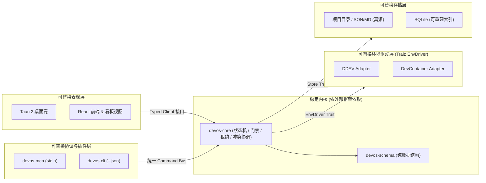

# 文档 10：框架演进解耦与多维冲突隔离设计 (`10-decoupling-and-conflict-isolation.md`)

## 一、框架解耦与防腐层架构（六边形架构）

全仓强制执行「内稳外活」原则：`devos-schema` 与 `devos-core` 构成零外部框架依赖的稳定内核；所有外部框架、环境引擎、Agent 协议与桌面壳退居外围适配器层。

### 解耦边界与替换策略
- **环境引擎**：内核仅调用 `EnvDriver` Trait，不直接解析 Docker/DDEV 专有数据。
- **协议层**：内部指令总线（CommandBus），`devos-mcp` 仅为薄协议翻译层。
- **各家 Agent 适配**：探测路径与格式全部抽离为 `agent-adapters.json` 声明式规则，支持热更新。
- **表现层**：前端统一收口到 `bridge.ts`。

---

## 二、应用内冲突治理（Intra-App Conflicts）

1. **容器名与网络名隔离**：生成全局唯一标识 `devos-<slug>-<4位hash>`（如 `devos-website-8k9m`），带标签 `com.devos.project_id`。
2. **端口租约**：全局 SQLite 维护 `port_leases`，锁定高位段（`18100-18999`），分配前用 `TcpListener::bind` 双重验证。
3. **多进程并发写入**：
   - 桌面端运行时，通过单写者守护模式（Single-Writer Daemon）串行落盘。
   - 桌面端未运行时，直连文件 + 跨进程文件锁（`fs2` advisory lock） + SQLite WAL 模式。
4. **文件监听回声消除**：维护 500ms 内过期内存集合 `self_written_hashes`，命中自身写入内容直接忽略。
5. **人机状态乐观锁**：携带递增版本号 `rev`，禁止 Agent 静默覆盖用户已关闭的 Issue 或未经测试将卡片移至 done。
6. **项目级环境互斥锁**：对 `up`/`down`/`snapshot`/`restore` 加项目级互斥锁，避免撞车。
7. **桌面端单实例锁**：引入 `tauri-plugin-single-instance`，多开时唤起已有窗口。

---

## 三、宿主机存量服务冲突治理（Host-Level Coexistence）

核心铁律：**「零侵入共存」—— 绝不强杀宿主机进程，绝不污染全局环境变量，绝不误删非 DevOS 容器。**

| 冲突类别 | 宿主机存量服务 | 隔离与共存方案 |
| --- | --- | --- |
| **1. 80 / 443 端口冲突** | IIS, phpStudy, LocalWP, 本机 Nginx | 启动前探测 80/443，若被占用自动将 DDEV 路由切至空闲高位端口（`18080/18443`）并更新预览 URL；数据库仅在内网通信。 |
| **2. 代理软件流量劫持** | Clash, v2rayN, Surge 等系统代理/TUN | 强制注入 `NO_PROXY=127.0.0.1,localhost,*.ddev.site,host.docker.internal`；体检向导增加本地回环代理绕过检查。 |
| **3. 宿主机同名 CLI 工具** | 用户自己装的旧版 ddev, node, git | 工具链全部私有化存放在 `~/.devos/bin/`，派生子进程时前置 PATH，不修改宿主机全局 PATH；和平共享已有 `ddev-router`。 |
| **4. Docker 资源与网络冲突** | 用户自己的 Compose / Ollama / 容器 | 容器强标签打标 `com.devos.managed=true`，任何清理按标签过滤，严禁全局 `docker prune`；非活跃项目空闲自动休眠。 |
| **5. `/etc/hosts` 与证书冲突** | 手动修改的 hosts, 企业 VPN hosts | 默认使用 `*.ddev.site` 公网泛解析至 `127.0.0.1`，无需改 hosts；复用宿主机已有 `mkcert` CA。 |
| **6. 外部 Agent 配置文件冲突** | 用户已配好的其他 5 个 MCP Server | 变更前备份 + 局部精准增删 `devos` 节点，TOML 保留注释。 |

---

## 四、冲突自愈交互（Conflict Doctor）

当端口发生不可避让冲突时：
1. **自动识别占用者**：通过系统探测反查占用进程名与 PID（如 `nginx.exe` 或 `Local`）。
2. **大白话指引与安全选项**：
   - 提示：`端口 8080 当前正被「Nginx」占用，无法启动当前项目预览。`
   - **主按钮（推荐）**：`[自动换用空闲端口启动]`（分配 18081 并刷新预览地址）
   - **次按钮（高级）**：`[查看占用进程详情]`（展示进程信息，绝不未经确认强制 kill 用户外部进程）
