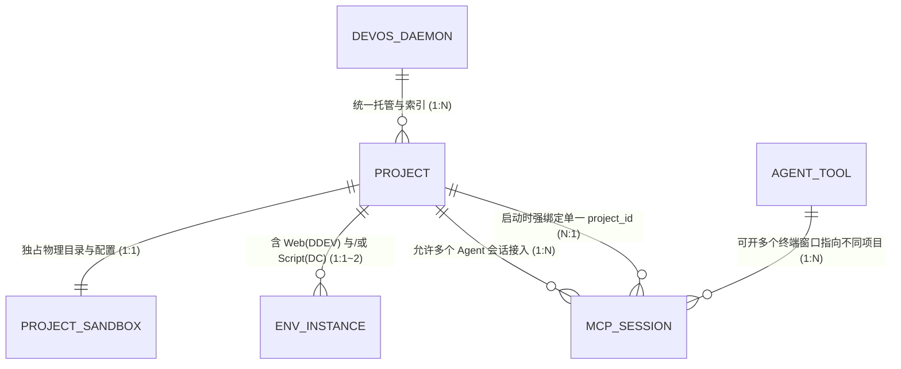

多项目并行与多 Agent 协同本质上是一个 **「1 个本地内核 × N 个隔离项目 × M 个外部 Agent 会话」** 的多对多（N:M）并发系统。单项目跑通很容易，一旦同时开 3 个项目、再挂 2 个不同的 Agent 工具（比如一个用 Factory Droid 改后端脚本，一个用 Claude Code 调前端页面），**串项目、抢资源、越权读写、操作迷路**就会集中爆发。

以下直接从**实体关系模型、运行隔离、安全防线、防呆操作**四个维度拆解完整设计，可直接作为仓库的 `docs/11-multi-project-multi-agent-model.md` 落盘。

---

## 一、核心实体关系模型（N:M 映射与绑定规则）

在架构上必须先明确 4 个实体的基数关系，杜绝隐式“当前全局项目”概念：

### 3 条核心关系铁律

1. **禁止“全局当前项目”作为 MCP 默认目标**：
* 桌面端 UI 可以有“当前正在浏览的项目 A”，但外部 Agent 工具绝不能依赖桌面端的“当前选中项”。
* 每个 `devos-mcp` 实例在启动时，**必须且只能通过自身启动目录（`cwd`）向上查找 `devos.json`，锁定唯一的 `project_id**`。哪怕桌面端切去看了项目 B，项目 A 终端里的 Agent 依然精准操作项目 A，绝不串台。

2. **支持“1 个 Agent 工具 × 多个项目”并行**：
* 用户可以在窗口 1 用 Claude Code 打开项目 A，在窗口 2 再开一个 Claude Code 打开项目 B。因为采用 `stdio` 传输，两个窗口各自拉起独立的 `devos-mcp` 进程，分别绑定 `proj_A` 和 `proj_B`，天然互不干扰。

3. **支持“多个 Agent 工具 × 同 1 个项目”协作**：
* 用户可以同时用 Factory Droid 和 WorkBuddy 接入同一个项目（例如一个修 `ISS-004`，一个写文档）。这要求内核对同一项目内的**容器启停、Issue 认领、看板写入**具备并发锁机制，而不是假设同一时间只有一个 Agent。

---

## 二、多项目隔离与同时运行的 5 层边界

多项目同时运行不只是“目录分开”，以下 5 层只要漏掉一层，就会出现诡异的跨项目污染：

| 隔离层级 | 同时运行时的典型冲突 | 工程级隔离实现 |
| --- | --- | --- |
| **1. 文件与资产层** | 相对路径误写到上级目录；共享临时目录导致导出文件名互相覆盖。 | 每个项目独占 `<workspace>/<slug>/`，所有产物、截图、日志严格落在各自的 `.devos/artifacts/` 与 `.devos/logs/`；全局 `~/.devos/index.sqlite` 仅存带 `project_id` 外键的索引记录。 |
| **2. 容器与网络层** | 项目 A 的脚本容器通过默认 `bridge` 网络直接连上项目 B 的数据库容器；或同时开 10+ 项目耗尽 Docker 默认子网池。 | 每个项目强制分配独立 Docker Network（`devos-net-<project_id_hash>`），**禁止项目间网络互通**；所有容器打 `com.devos.project_id=<id>` 标签；项目停止时释放网络，避免子网耗尽。 |
| **3. 端口与域名层** | 两个项目同时起 Web 或 API 服务抢占同一端口。 | DDEV 按唯一项目名分配独立域名（`[https://proj-a.ddev.site](https://proj-a.ddev.site)` / `[https://proj-b.ddev.site](https://proj-b.ddev.site)`），共用 `ddev-router` 反向代理；DevContainer 脚本服务与本地预览代理全部从 `port_leases` 高位段（`18100–18999`）动态分配，互不冲突。 |
| **4. 浏览器预览隔离层（极易忽略）** | 如果两个降级预览页都跑在 `[http://127.0.0.1](http://127.0.0.1):<不同端口>`，**浏览器规范中 Cookie 是按主机名（忽略端口）共享的**！项目 A 登录的 Session Cookie 会直接污染项目 B，导致登录态错乱。 | 1. 优先用独立子域名（`*.ddev.site`）天然隔离 Cookie 与 `localStorage`； 

 2. 降级到回环地址时，为每个项目的 Tauri Child WebView 配置**独立的 `data_directory`（独立存储分区）**，彻底隔离 Cookie、缓存与 IndexedDB。 |
| **5. 宿主机算力资源层** | 小白同时点了 4 个项目启动，每个项目跑 MySQL + PHP + Python 容器，16GB 内存电脑直接卡死、风扇狂转。 | 内核设置**软性并发上限**（默认同时运行不超过 2–3 个项目，可配）与**空闲自动休眠策略**（非活跃项目超过 30 分钟无预览访问且无脚本运行，自动提示或静默暂停容器释放内存）。 |

---

## 三、多项目 × 多 Agent 下的核心安全问题与防线

在多项目共存的情况下，最大的安全风险不是外部黑客，而是「AI 越界（Cross-Project Contamination）」——无论是模型幻觉还是间接提示词注入，一旦一个项目的 Agent 越权改了另一个项目的代码或窃取了密钥，后果非常严重。

### 1. MCP 会话级沙箱监禁（Project-Scoped Jail）

* **风险**：全局 `daemon.json` 里的 Token 如果对所有项目通用，项目 A 里失控的 Agent 可以通过猜或枚举 `project_id` 去调用 `env_control` 删项目 B 的快照或读项目 B 的文件。
* **防线**：
* `devos-mcp` 启动握手时，先向守护进程提交 `cwd`，守护进程校验合法后签发一个**仅绑定该 `project_id` 的会话级作用域 Token（Scoped Session Token）**。
* 后续该会话的所有 MCP 工具调用（`env_control`、`list_issues`、`sync_project_assets`）强制从 Token 提取 `project_id`，**完全忽略请求参数里试图传入的其他 `project_id**`，从协议层彻底封死跨项目越权。

### 2. 路径穿越与符号链接（Symlink）逃逸防护

* **风险**：`devos.run.json` 的参数或 `sync_project_assets` 传入 `../../proj_B/.env`，或者项目 A 里放了一个指向宿主机 `~/.ssh` 的软链接。
* **防线**：所有文件读写和脚本入参路径在执行前，Rust 端必须执行 `fs::canonicalize()` 解析真实物理路径，并强制校验 `real_path.starts_with(project_root_canonical)`；不满足直接拒绝并返回 `ERR_PATH_OUT_OF_SANDBOX`。

### 3. 密钥（`.env`）与凭据跨项目隔离

* **风险**：多个项目各自存了不同的支付密钥、数据库密码、第三方 API Key；如果统一放在全局配置或允许 Agent 直接读取，容易串用或随日志外泄。
* **防线**：
* 每个项目的敏感配置严格隔离在各自目录的 `.env` 中，绝不写入全局 SQLite，也不随 `get_project_brief` 下发。
* 日志采集器（Web 报错探针与脚本 `stderr` 截取）在落盘 `ISS-xxx.json` 前，统一经过一层**内置脱敏过滤器**（匹配常见 `sk-`、`Bearer `、数据库连接串、高熵 Token 并替换为 `***REDACTED***`），防止密钥顺着报错堆栈发给外部模型。

### 4. 多 Agent 并发修改同一项目的状态安全

* **风险**：用户同时开了 Droid 和 Claude Code 处理同一个项目，两个 Agent 同时改同一张看板卡片、同时认领同一个 `ISS-004`、或一个在 `snapshot` 还原数据库时另一个正在跑迁移脚本。
* **防线**：
* **环境操作互斥锁**：同一项目的 `env_control` 状态变更（`up`/`down`/`snapshot`/`restore`）串行执行，冲突时返回 `ENV_LOCKED_BY_OTHER_AGENT`。
* **Issue 独占认领（Claim Lock）**：`ISS-xxx.json` 增加 `claimed_by`（记录 `agent_name + session_id + timestamp`）；已被认领且 30 分钟内活跃的 Issue，其他 Agent 调用 `list_issues` 时会看到明确提示「正由 Claude Code 处理中」，避免重复劳动和代码覆盖。
* **人类决策不可覆盖**：用户手动关闭的 Issue、手动修改的模式（如切到 `DEPLOY_PROD`），Agent 无权静默逆转。

---

## 四、面向低开发基础用户的操作与交互问题（防呆设计）

技术上隔离干净后，实际使用中最大的阻碍往往来自**人的认知负荷**——面对多个项目、多个终端窗口、多个运行中的环境，小白极易点错、发错、把电脑跑卡。

### 1. 解决“我到底在跟哪个项目的 AI 说话？”（上下文锚定）

* **痛点**：小白在 DevOS 里复制了一条 `ISS-004` 的修复指令，结果切到终端时粘贴进了**项目 B** 的 Agent 窗口。
* **操作防呆**：
1. **指令携带项目身份指纹**：点「复制指令给 AI」时，复制的内容不是光秃秃的 `处理 ISS-004`，而是带上项目名和编号：`请处理「发票自动整理工具」(invoice-helper) 的 ISS-004`。
2. **MCP 自动纠错拦截**：如果用户真粘贴错了窗口，项目 B 里的 Agent 调用 `list_issues` 查找 `ISS-004` 或校验项目名不匹配时，`devos-mcp` 直接返回明确提示：`当前窗口绑定的是「官网项目」，但你要处理的任务属于「发票自动整理工具」，请提示用户切换到正确窗口`。Agent 立刻就能在终端里提醒小白“你发错窗口了”。
3. **连接状态精准归属**：在 DevOS 左侧栏每个项目卡片下方，直接显示当前连入**该项目**的活跃 Agent 徽章（例如项目 A 显示 `🟢 Droid 已连接`，项目 B 显示 `🟢 Claude 已连接`），一目了然。

### 2. 解决“同时开太多项目把电脑拖卡”（算力可视化与一键休眠）

* **痛点**：小白不知道后台开着 3 个 Docker 环境会吃掉 8GB 内存，电脑变卡只会觉得“你这个软件太卡了”。
* **操作防呆**：
* 左侧栏底部常驻一个极简的「运行中项目：2 个」状态胶囊（只显示运行数与整体健康色，不堆复杂监控曲线）。
* 当用户启动第 3 个项目且检测到宿主机可用内存低于阈值（如剩余 `< 2GB`）时，弹出温和引导：`当前已有 2 个项目在运行，同时启动可能让电脑变慢` $\rightarrow$ 提供 **`[暂停其他闲置项目并启动当前项目]`**（推荐默认）与 **`[仍然同时启动]`**。
* 提供一键 **`[停止全部环境]`** 按钮，下班或合盖前点一下彻底释放电脑内存。

### 3. 解决“切换项目时，后台任务去哪了？”（异步任务托盘）

* **痛点**：用户在项目 A 点击了「运行耗时 2 分钟的数据抓取脚本」或「初始化容器」，随后切到项目 B 看看板，切回来时以为任务断了或者忘了刚才在跑什么。
* **操作防呆**：
* 顶部状态条右侧设一个全局「后台任务气泡」（无任务时隐藏，有任务时显示旋转图标与数量，如 `2 个任务运行中`）。
* 无论当前停留在哪个项目，点击气泡都能看到跨项目的长耗时任务进度（项目 A 正在拉取环境 65%、项目 B 脚本已运行 42 秒），支持直接跳转或一键取消；任务完成或失败时发原生系统通知并标注所属项目名。

### 4. 解决“多项目同时提测，通知混在一起”

* **痛点**：两个 Agent 在后台同时干活，接连弹通知，小白分不清哪个是哪个。
* **操作防呆**：
* 所有系统通知与未读红点**严格按项目聚合**——左侧栏项目列表上直接挂各自的数字徽章（例如 `待测 2` / `待复测 1`），点击桌面通知自动切换左侧选中项目并直达对应的测试台或 Issue 详情，不让用户自己翻找。

把“会话级 `project_id` 强制监禁 + 独立网络/WebView 分区 + 错窗粘贴自动拦截 + 算力超载引导休眠”这四块补齐后，这套多项目多 Agent 的协同架构才算真正具备面向普通用户的长期可用性。
