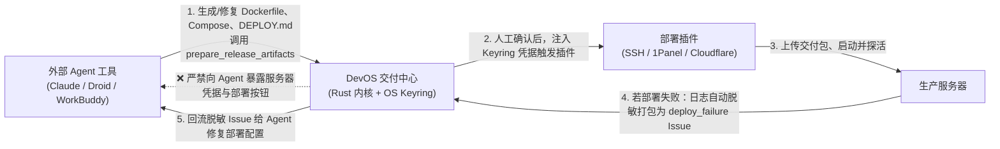

# 文档 12：标准交付打包与部署插件设计（`12-delivery-and-deploy-plugins.md`）

## 一、行业同类产品对标与可借鉴机制

在“**本地开发为主，部署通过生成标准文件/文档 + 插件辅助完成**”这条路径上，行业里没有一款全包圆的产品，但有三类成熟工具各自把其中一段做到了标杆水平：

| 同类产品 | 核心定位 | 最值得借鉴的交付与部署机制 | 对 DevOS 的直接启发 |
| --- | --- | --- | --- |
| **`docker init`**（Docker 官方 CLI） | 本地项目一键容器化初始化 | 扫描项目技术栈（Python/Node/Go 等），交互问答后自动生成 `Dockerfile`、`.dockerignore`、`compose.yaml` 以及**面向人类阅读的 `README.Docker.md**`。明确声明“只负责生成规范起点，不接管生产运维”。 | “部署配置 + 部署说明文档（`DEPLOY.md`）成套产出”的直接范本；适合作为交付物生成的标准模板思路。 |
| **`Devbox`**（Jetify 开源） | 本地可复现开发环境 | 用一份 `devbox.json` 锁死本地依赖，交付时通过 `devbox generate dockerfile` 直接从本地环境声明导出生产用 `Dockerfile`，消除“本地能跑、上线报错”的环境漂移。 | 借鉴其“从 `devos.json` 单一真源推导生产构建文件”的原则，确保本地版本与生产版本口径一致。 |
| **`Railpack` / `Nixpacks**`（Railway 开源） | 零配置应用打包构建器 | 自动分析代码目录生成 JSON 格式的确定性构建计划（Build Plan），并通过 BuildKit 隔离构建期密钥，防止敏感变量泄露进日志或最终镜像。 | 借鉴其“JSON 构建计划 + 密钥绝不打进制品/镜像”的安全打包机制。 |
| **`LocalWP`**（Local by Flywheel） | 面向非开发用户的本地 Web 桌面端 | 两条交付出口并行：① 右键 **Export** 一键打出包含站点文件与 `.sql` 数据库转储的自包含 `.zip` 包，方便发给任意主机手动导入；② 通过 **Add-on / Connect 插件**（如 WP Engine、InstaWP Connect）一键推送到指定主机。 | **最贴合小白心智的双出口交互**：不懂服务器就导 `.zip` 交给运维/面板，有目标主机就装对应部署插件一键推。 |
| **`DDEV Providers`**（DDEV 原生集成） | 本地环境与上游主机的数据桥接 | 在 `.ddev/providers/*.yaml` 中通过**声明式 YAML 配方**定义 `db_push_command`、`files_push_command` 等动作连接不同托管商；且官方明确警示生产推送风险，允许按需禁用 `push`。 | 你的 Web 引擎本身基于 DDEV，可直接复用或封装其声明式 Provider 配方思路，同时把高危生产推送加上强确认门禁。 |
| **`Kamal`**（37signals 开源） | 面向任意 Linux VPS 的容器部署工具 | 用一份简洁的 `deploy.yml` + 独立 `.kamal/secrets` 文件通过 SSH 完成零停机部署，支持配置 `accessories`（MySQL/Redis 等伴生服务）并自动保留最近 `retain_containers` 个旧版本用于秒级回滚。 | 极适合作为 DevOS **「通用 Linux VPS（SSH + Docker）」部署插件**的底层执行范式。 |

---

## 二、标准交付物规范（打包部署文件 + 部署文档）

无论用户是否使用部署插件，DevOS 都必须能一键产出一份**脱离 DevOS 也能独立上线**的标准交付包（存放在 `<project-root>/releases/vX.Y.Z/`，并支持导出为 `.zip`）。

### 1. 交付包标准目录结构

```text
releases/v1.0.0/
├── release-manifest.json       # 机器可读交付清单（供部署插件读取）
├── DEPLOY.md                   # 小白/运维可读部署文档（随 user_locale 生成）
├── .env.prod.example           # 生产环境变量模板（带中文说明，绝不含真实密钥）
├── deploy/                     # 生产部署配置文件（按项目形态按需生成）
│   ├── Dockerfile              # 生产镜像构建文件（多阶段构建、非 root 用户）
│   ├── docker-compose.prod.yml # 一键启动编排（含应用、数据库/Redis、健康检查）
│   ├── .dockerignore           # 排除 .git / .devos / .env / 缓存
│   ├── nginx.prod.conf         # （可选）Web 反向代理与静态缓存模板
│   └── schedule.cron.example   # （可选）后端脚本定时任务 / systemd 模板
├── db/                         # （可选，Web/CMS 含初始数据时）
│   └── init-sanitized.sql.gz   # 已做本地域名清洗与脱敏的初始化数据库包
└── app/                        # 干净的应用源码或编译后静态产物（已剔除 .devos/ 与本地临时文件）

```

### 2. `release-manifest.json`（交付清单协议）

由 DevOS 内核在打包阶段自动生成并计算校验和，下游部署插件只需读取此文件即可知道“要部署什么、依赖什么、怎么验活”：

```json
{
  "schema_version": "1.0",
  "project_id": "proj_01JXYZ8K9M2N",
  "project_slug": "invoice-helper",
  "version": "1.0.0",
  "project_type": "hybrid",
  "created_at": "2026-11-23T10:30:00Z",
  "artifacts": {
    "bundle_zip": "invoice-helper-v1.0.0.zip",
    "sha256": "e3b0c44298fc1c149afbf4c8996fb924..."
  },
  "runtime_requirements": {
    "min_cpu_cores": 2,
    "min_memory_mb": 2048,
    "services": ["mysql:8.0", "redis:7-alpine"],
    "exposed_ports": [80, 443]
  },
  "required_env_keys": [
    { "key": "APP_DOMAIN", "label": "线上访问域名", "secret": false },
    { "key": "DB_PASSWORD", "label": "生产数据库密码", "secret": true },
    { "key": "OCR_API_KEY", "label": "发票识别接口密钥", "secret": true }
  ],
  "deploy_entry": {
    "compose_file": "deploy/docker-compose.prod.yml",
    "health_check_path": "/health",
    "expect_status": 200
  }
}

```

### 3. `DEPLOY.md`（标准化部署文档模板约束）

在项目标准（`standards/`）与 Agent `SKILL.md` 中硬性规定，Agent 协助生成或更新 `DEPLOY.md` 时必须包含以下 6 个固定章节（使用 `user_locale` 对应语言，面向非运维人员）：

1. **服务器最低要求**：明确写出推荐 CPU/内存、操作系统（如 Ubuntu 22.04/24.04）、需放行的防火墙端口（80/443）。
2. **上线前准备清单**：列出需要提前准备好的域名解析和 `.env.prod.example` 里每一项变量的获取方式。
3. **3 步快速启动指南**：给出可直接复制粘贴的命令（针对 1Panel/宝塔面板用户给出“上传解压 $\rightarrow$ 导入 Compose $\rightarrow$ 填环境变量启动”的图形化步骤）。
4. **首次运行验证方法**：明确写出访问哪个 URL 或跑哪条命令、看到什么输出才算上线成功。
5. **数据备份与版本回滚**：写出如何备份挂载卷/数据库，以及升级失败时如何切回上一版本。
6. **常见报错速查**：针对端口冲突、权限不足、数据库连接失败列出 3～5 条最常见排查动作。

### 4. 打包前自动体检门禁（Release Preflight）

点击「生成交付包」或 Agent 调用 `prepare_release_artifacts` 时，Rust 内核强制执行 5 项离线检查，任意一项不通过即拦截并给出精确提示：

* **本地地址硬编码扫描**：正则扫描业务代码与配置文件，拦截残留的 `*.ddev.site`、`localhost:`、`127.0.0.1:` 硬编码。
* **敏感凭据防泄露扫描**：校验 `app/` 与 `deploy/` 中绝不包含 `.env` 真实文件、私钥（`.pem`/`id_rsa`）及高熵 API Key。
* **垃圾文件剔除确认**：强制过滤 `.devos/`、测试截图、`node_modules/`、`__pycache__/`、`.git/`。
* **环境变量对齐检查**：核对代码中引用的必填环境变量是否全部登记在 `.env.prod.example` 与 `release-manifest.json` 中。
* **生产配置静态校验**：校验 `docker-compose.prod.yml` 语法合法性，且包含重启策略（`restart: unless-stopped`）与 `healthcheck` 定义。

---

## 三、部署插件架构设计（松耦合、轻内核、高安全）

为了不让 DevOS 内核被各家云厂商和服务器面板拖成重型运维软件，部署能力严格采用“内核只管交付包与标准向导，具体推送全交部署插件”的架构。

### 1. 插件扩展形态（双形态兼容）

参考 DDEV Provider 配方 与 Kamal 声明式配置，支持两种粒度的部署插件：

* **轻量配方型插件（Recipe Plugin，YAML/JSON）**：适合 1Panel 编排导出、SSH + `docker compose` 推送、静态文件 `rsync`/S3 上传。只需声明表单字段、预检命令、上传与启动模板，由 DevOS 内置的通用执行器解释运行，维护成本极低。
* **独立二进制/脚本型插件（Executable Plugin）**：适合需要复杂 API 交互的托管商（如 Cloudflare Pages、阿里云/腾讯云 API、特定主机面板）。通过标准 `stdin/stdout` JSON 协议与 DevOS 通信，彻底隔离依赖与崩溃风险。

### 2. 部署插件标准接口（6 个生命周期动作）

| 动作 | 输入 | 输出 | 桌面端渲染与安全控制 |
| --- | --- | --- | --- |
| `schema` | 无 | 插件元信息 + 表单字段定义（标明哪些字段为 `secret`） | 桌面端自动渲染配置表单；`secret` 字段掩码输入并存入系统原生钥匙串（OS Keyring）。 |
| `validate` | 目标配置（非密钥）+ 运行时注入凭据 | 连通性、远端 Docker/面板版本、磁盘余量检测结果 | 红绿灯展示目标服务器是否具备上线条件。 |
| `plan` | `release-manifest.json` + 目标配置 | 即将上传的文件清单、端口占用、变更摘要 | **强制人工审批页**：小白必须点击「确认发布」才进入下一步。 |
| `apply` | 交付包路径 + 目标配置 + 凭据 | 流式进度事件（百分比 + 当前步骤白话说明） | 桌面端展示分阶段进度条，底层 SSH/API 日志默认折叠。 |
| `verify` | `release-manifest.json` 的 `health_check` | 线上访问 URL、HTTP 状态码或脚本自检结果 | 成功则亮绿灯并展示「打开线上站点」；失败则高亮「一键回滚」与「生成诊断 Issue」。 |
| `rollback` | 上一可用版本 ID | 回滚结果与探活状态 | 每次覆盖发布前自动保留上一版本镜像/目录与数据库备份点，支持 1 键恢复。 |

### 3. 角色与安全铁律（AI 与生产环境的绝对防火墙）



---

## 四、首批交付模板与部署插件落地优先级

结合国内与海外用户的真实使用习惯，建议按以下 3 个梯队逐步补齐，避免初期战线拉得太长：

1. **第一梯队（MVP 随首个版本内置，零服务器依赖）**：
* **标准交付包导出（Universal Bundle Exporter）**：一键生成含 `Dockerfile`、`docker-compose.prod.yml`、`.env.prod.example`、`DEPLOY.md` 的 `.zip` 交付包；同时提供 **「1Panel / 宝塔面板友好格式」** 勾选（自动按面板习惯整理 Compose 与数据卷相对路径）。


2. **第二梯队（覆盖 80% 独立服务器与轻量建站需求）**：
* **通用 Linux VPS 插件（SSH + Docker Compose）**：输入服务器 IP、SSH 密钥/密码、域名，自动上传交付包、拉起容器并配置基础反向代理与版本保留回滚。
* **静态站点托管插件（Cloudflare Pages / 阿里云 OSS / 腾讯云 COS）**：适合纯前端 Web 项目，免去买服务器配运维的门槛。


3. **第三梯队（垂直场景与社区扩展）**：
* **CMS 专项迁移插件**：基于 DDEV 导出数据库与 `uploads/wp-content` 资源包，自动完成本地域名到线上域名的安全替换（参考 LocalWP / WP-CLI 迁移流）。
* **开放部署插件规范与市场清单**：通过轨道 B 的静态清单分发社区贡献的部署插件（如 Coolify API、Dokploy API、Vercel、宝塔 API 等），用户按需在 DevOS 内一键安装。
