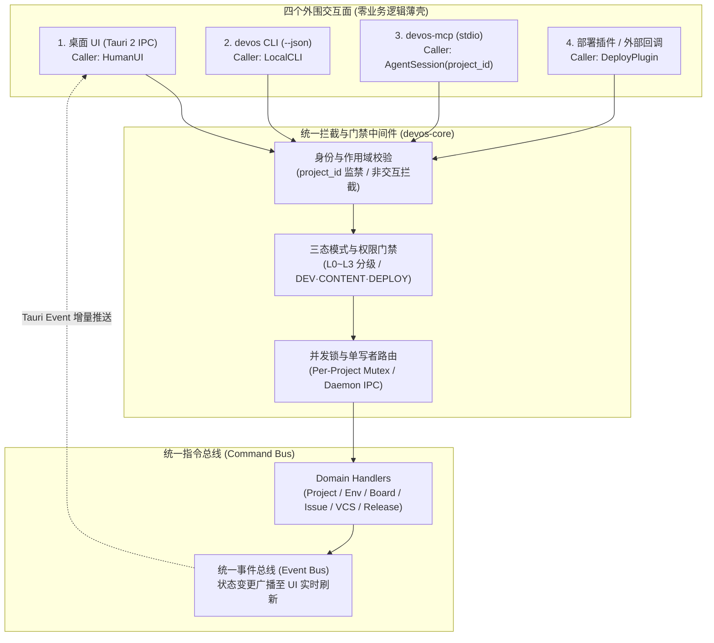

# 文档 14：统一指令总线、CLI / MCP / UI / 插件协议总规范（`14-unified-command-protocol-and-control-plane.md`）

随着环境管理、项目管理、测试反馈、版本控制、标准交付与部署插件全部落位，系统存在 **4 个控制入口**（桌面 UI、本地 `devos` CLI、外部 Agent 的 `devos-mcp`、以及下游部署插件）。为避免“UI 写一套逻辑、CLI 写一套逻辑、MCP 再写一套逻辑”导致行为分裂与安全绕过，全系统强制收敛为 **「单指令总线（Command Bus），四端统一映射」** 架构。

---

## 一、统一控制面架构（One Core, Four Surfaces）

核心原则：**UI、CLI、MCP 都是无业务逻辑的薄壳适配器（Thin Adapters）**。所有能力统一在 `devos-core` 中注册为带强类型入参、出参和权限等级的 `Command`，经过同一道安全与模式门禁中间件后执行。



### 3 条架构硬约束

1. **单写者路由透明化**：无论指令来自 UI、CLI 还是 MCP，只要检测到 `~/.devos/daemon.json` 中的桌面守护进程存活，一律通过本地回环 IPC 转发给守护进程串行执行，执行后通过 `EventBus` 毫秒级刷新桌面 UI；守护进程未启动时，CLI/MCP 自动降级为带文件锁直连本地内核。
2. **CLI 与 MCP 同源生成**：`devos-cli` 和 `devos-mcp` 共享 `devos-schema` 的同一套参数结构体与 JSON Schema 描述，新增一个内核能力时，只需注册一次 `Command`，CLI、MCP 和 Tauri IPC 同步获得类型安全的定义。
3. **防 Agent 借 Shell 绕过门禁**：外部 Agent 除了调 MCP，通常还拥有宿主机 Bash 执行权，可能会尝试直接敲 `devos deploy apply` 或 `devos git push`。因此 **L3 级高危指令强制校验调用来源**：凡未携带桌面 UI 签发的短时效确认票据（UI Confirmation Nonce）或非交互式 TTY 调用，内核一律拦截拒绝。

---

## 二、统一权限分级与安全门禁（Human vs. Agent）

内核对每一条 `Command` 标定唯一的权限等级，并在中间件层强制执行：

| 权限等级 | 名称 | 允许调用方 | 典型场景 | 护栏机制 |
| --- | --- | --- | --- | --- |
| **L0** | **只读查询** | UI / CLI / MCP（默认免审批） | 读 Brief、查环境状态、查看板、读 Issue、看 Git Diff | 强制锁定在当前会话绑定的 `project_id` 内；自动过滤 `.env` 真实值。 |
| **L1** | **本地安全写** | UI / CLI / MCP | 更新需求/文档/知识、推进卡片（限 `todo/doing`）、建影子快照、提测自检、解决 Issue | 写入前走 Schema 校验与路径沙箱校验；禁止跳过 `testing` 直接标 `done`。 |
| **L2** | **受控状态变更** | UI / CLI / MCP（受三态模式约束） | 容器启停、容器内 `exec`、还原快照、生成交付配置（`prepare_release_artifacts`） | 受 `devos.json` 模式限制（如 `DEPLOY_PROD` 下禁止破坏性操作）；需项目级互斥锁。 |
| **L3** | **人类独占高危** | **仅限 UI（或需人工二次确认的交互 CLI）** | 读写真实 `.env` 与 OS Keyring、推送远程 Git 仓库、执行线上部署插件、删除项目、安装/卸载外部 Agent 插件 | **MCP 协议层彻底不暴露**；CLI 层检测到非人工交互或无 UI 确认票据直接返回 `ERR_HUMAN_APPROVAL_REQUIRED`。 |

---

## 三、全功能统一能力映射总表（Command / CLI / MCP / UI）

下表将系统全部核心功能按 7 大域收口，明确每一项的**内部指令 ID、CLI 语法、MCP 工具映射、桌面 UI 对应控件及权限等级**。

### 域 1：项目生命周期与环境控制（Project & Env）

| 内部 Command ID | `devos` CLI 命令 | MCP Tool 映射 | 桌面 UI 入口 | 权限等级 |
| --- | --- | --- | --- | --- |
| `project.brief` | `devos brief --json` | `get_project_brief` | 顶部项目概览 / 自动上下文 | **L0** |
| `project.create` | `devos project create --type <t> --name <n>` | *（仅支持轻量建骨架，推荐 UI 主建）* | 左侧栏「+ 新建项目」向导 | **L2** |
| `project.mode.set` | `devos mode set <DEV_LOCAL|CONTENT_LOCAL|DEPLOY_PROD>` | *不暴露（仅人类切态）* | 顶部模式胶囊下拉 | **L3** |
| `project.delete` | `devos project archive <id>` | *不暴露* | 项目设置 → 移入回收站 | **L3** |
| `env.status` | `devos env status --target <web|script>` | `env_control(action="status")` | 顶部环境健康状态灯 | **L0** |
| `env.up` / `env.down` | `devos env up|down --target <web|script>` | `env_control(action="up|down")` | 顶部「启动 / 停止环境」主按钮 | **L2** |
| `env.exec` | `devos env exec --target <t> -- <cmd>` | `env_control(action="exec")` | 仅限内部/脚本测试台触发 | **L2** |
| `env.snapshot` / `restore` | `devos env snapshot|restore --name <n>` | `env_control(action="snapshot|restore")` | 顶部「保存 / 还原状态」下拉 | **L2** |

### 域 2：项目资产与敏感配置（Assets & Secrets）

| 内部 Command ID | `devos` CLI 命令 | MCP Tool 映射 | 桌面 UI 入口 | 权限等级 |
| --- | --- | --- | --- | --- |
| `asset.upsert` | `devos asset upsert --type <req|doc|knowledge|run_manifest>` | `sync_project_assets` | 「项目资产」Markdown 编辑器 | **L1** |
| `asset.read` | `devos asset get --type <t> --id <id>` | `get_project_brief`（按需展开） | 「项目资产」分类树阅读区 | **L0** |
| `secret.schema.check` | `devos env-vars check` | `get_project_brief`（仅返回缺失键名） | 顶部配置漂移黄灯提示 | **L0** |
| `secret.set` / `rollback` | `devos env-vars set|rollback`（仅交互 TTY） | *严禁暴露（防密钥外泄）* | 项目资产 → 「密钥与配置」表单 | **L3** |

### 域 3：看板进度与人机决策（Board & Decisions）

| 内部 Command ID | `devos` CLI 命令 | MCP Tool 映射 | 桌面 UI 入口 | 权限等级 |
| --- | --- | --- | --- | --- |
| `board.upsert` | `devos board upsert --card <id> --col <todo|doing>` | `update_board_card` | 4 列看板拖拽 / 新建卡片 | **L1** |
| `board.complete` | `devos board complete --card <id>` | *不暴露（仅用户验收后完成）* | 测试台「全部通过，标记完成」 | **L3** |
| `decision.create` | `devos decision create --question "..."` | `request_user_decision` | 看板顶部待拍板决策卡片 | **L1** |
| `decision.resolve` | `devos decision resolve --id <id> --option <o>` | *不暴露（仅人类拍板）* | 决策卡片选项按钮 | **L3** |

### 域 4：标准化测试、预览与 Issue 闭环（Testing & Issues）

| 内部 Command ID | `devos` CLI 命令 | MCP Tool 映射 | 桌面 UI 入口 | 权限等级 |
| --- | --- | --- | --- | --- |
| `test.submit` | `devos test submit --card <id> --checklist <json>` | `submit_for_testing` | 自动推至「待我测试」+ 系统通知 | **L1** |
| `test.run_target` | `devos run <target_id> --param k=v` | `env_control(action="exec")` | 脚本测试台表单「运行测试」 | **L2** |
| `issue.create` | `devos issue create --source <web|script|deploy>` | *（通常由 UI/系统生成）* | Web 框选「提问题」/ 脚本「一键转 Issue」 | **L1** |
| `issue.list` | `devos issue list --status <open|reopened|all>` | `list_issues` | Issue 中心左侧列表 | **L0** |
| `issue.resolve` | `devos issue resolve --id <ISS-xxx> --summary "..."` | `resolve_issue` | 触发顶部绿色「待复测」横幅 | **L1** |
| `issue.verify` | `devos issue close|reopen --id <ISS-xxx>` | *不暴露（仅人类复测确认）* | Issue 详情「确认已修好 / 还是不行」 | **L3** |

### 域 5：版本控制、影子时光机与远程同步（VCS & Remote）

| 内部 Command ID | `devos` CLI 命令 | MCP Tool 映射 | 桌面 UI 入口 | 权限等级 |
| --- | --- | --- | --- | --- |
| `vcs.status` / `diff` | `devos vcs status|diff --json` | `vcs_checkpoint(action="status")` | 「版本与同步」当前改动列表 | **L0** |
| `vcs.checkpoint.create` | `devos checkpoint create --note "..."` | `vcs_checkpoint(action="create")` | 顶部「历史时光机」自动/手动存档 | **L1** |
| `vcs.checkpoint.restore` | `devos checkpoint restore --id <cp_id>` | *不暴露（防 AI 误回滚用户改动）* | 时光机「回到此版本」按钮 | **L3** |
| `vcs.commit` | `devos vcs commit -m "..."` | *不暴露或仅由用户触发* | 「保存新版本」按钮 | **L2/L3** |
| `vcs.remote.sync` | `devos vcs push|pull`（含密钥扫描门禁） | *严禁暴露（防密钥推公网）* | 「同步到云端仓库」按钮 | **L3** |

*(说明：此处在原 9 个 MCP 工具基础上，视需要可选暴露第 10 个极轻量工具 `vcs_checkpoint`，仅允许 Agent 查询状态与在大幅改代码前主动打影子快照，绝不允许回滚或推送远程。)*

### 域 6：交付打包与部署插件（Delivery & Deploy Plugins）

| 内部 Command ID | `devos` CLI 命令 | MCP Tool 映射 | 桌面 UI 入口 | 权限等级 |
| --- | --- | --- | --- | --- |
| `release.prepare` | `devos release prepare --version <vX.Y.Z>` | `prepare_release_artifacts` | 「交付中心」预检与生成交付包 | **L2** |
| `release.export` | `devos release export --version <vX.Y.Z> --out <zip>` | *不暴露* | 「导出交付包 (.zip)」按钮 | **L3** |
| `deploy.plugin.validate` | `devos deploy validate --plugin <id> --target <t>` | *不暴露* | 部署向导 Step 1「测试服务器连接」 | **L3** |
| `deploy.plugin.apply` | `devos deploy apply --plugin <id> --release <v>` | *严禁暴露（生产防火墙）* | 部署向导「确认发布到生产环境」 | **L3** |
| `deploy.plugin.rollback` | `devos deploy rollback --plugin <id> --target <t>` | *严禁暴露* | 线上状态页「一键回滚」按钮 | **L3** |

### 域 7：系统体检、Agent 适配与日志（System & Adapters）

| 内部 Command ID | `devos` CLI 命令 | MCP Tool 映射 | 桌面 UI 入口 | 权限等级 |
| --- | --- | --- | --- | --- |
| `system.doctor` | `devos doctor --json` | *（仅返回摘要状态）* | 首次启动体检向导 / 左下角体检灯 | **L0** |
| `adapter.scan` | `devos agents scan --json` | *不暴露* | 「连接 Agent 工具」扫描列表 | **L0** |
| `adapter.install` / `uninstall` | `devos agents install|uninstall <agent_id>` | *严禁暴露（改外部配置）* | Agent 卡片「安装 / 卸载插件」 | **L3** |
| `system.diag.export` | `devos diag export --out <zip>` | *不暴露* | 设置 → 「导出脱敏诊断包」 | **L3** |

---

## 四、统一通信信封与错误码协议（Response & Error Spec）

无论通过 Tauri IPC、CLI `--json` 还是 MCP Tool 返回，数据格式严格遵循同一套信封（Envelope），避免前端、CLI 脚本和 Agent 写多套解析逻辑。

### 1. 成功返回信封

```json
{
  "protocol_version": "1.0",
  "ok": true,
  "command_id": "issue.list",
  "project_id": "proj_01JXYZ8K9M2N",
  "data": {
    "issues": [ "..."]
  },
  "meta": {
    "duration_ms": 18,
    "truncated": false,
    "user_locale": "zh-CN"
  }
}

```

### 2. 失败返回信封（双语分治：前端靠 `code` 翻译，Agent 靠 `hint` 自愈）

```json
{
  "protocol_version": "1.0",
  "ok": false,
  "command_id": "test.submit",
  "project_id": "proj_01JXYZ8K9M2N",
  "error": {
    "code": "GATE_SMOKE_CHECK_FAILED",
    "params": {
      "target": "web",
      "url": "https://invoice-helper.ddev.site/health",
      "status": 500
    },
    "message": "Web health check returned HTTP 500.",
    "hint": "Inspect the backend error excerpt below, fix the 500 error in container, and re-run submit_for_testing.",
    "retryable": true,
    "untrusted_log_excerpt": "ModuleNotFoundError: No module named 'openpyxl'"
  }
}

```

### 3. 核心错误码命名域规范

统一采用 `<DOMAIN>_<SPECIFIC_REASON>` 全大写下划线格式，前端 `errors.json` 按此精确匹配多语言文案：

* **`AUTH_*`**：`AUTH_SCOPE_VIOLATION`（跨项目越权）、`AUTH_HUMAN_APPROVAL_REQUIRED`（L3 拦截）、`AUTH_INVALID_TOKEN`
* **`GUARDRAIL_*`**：`GUARDRAIL_MODE_BLOCKED`（三态模式拦截）、`GUARDRAIL_PATH_OUT_OF_SANDBOX`（路径穿越）、`GUARDRAIL_SKIP_TESTING_FORBIDDEN`（跳过测试直接完成）、`GUARDRAIL_SECRET_DETECTED`（推送/打包检出密钥）
* **`ENV_*`**：`ENV_DOCKER_NOT_RUNNING`、`ENV_PORT_CONFLICT`、`ENV_BUSY_LOCKED`、`ENV_EXEC_TIMEOUT`
* **`GATE_*`**：`GATE_SMOKE_CHECK_FAILED`、`GATE_RELEASE_PREFLIGHT_FAILED`、`GATE_CONTEXT_MISMATCH`（粘贴错项目窗口）

---

## 五、四端对接协议细节约定

### 1. Agent 工具 $\leftrightarrow$ DevOS（MCP 优先 + CLI 兜底）

* **首选通道（`devos-mcp` via `stdio`）**：启动时读取当前工作目录 `devos.json` 与 `~/.devos/daemon.json`，向守护进程换取绑定单一 `project_id` 的 **Scoped Session Token**。
* **降级通道（`devos <cmd> --json`）**：针对暂未开启 MCP 或在子脚本中执行的场景。CLI 自动检测非 TTY 输出并关闭 ANSI 颜色与动画，吐出纯净单行 JSON；同样基于 `cwd` 自动锁定 `project_id`。
* **结果防爆与防注入约定**：所有返回给 Agent 的日志字段统一上限为 **50 行或 4KB**（超出时 `meta.truncated = true` 并附本地完整日志路径），且外部抓取内容强制放在 `untrusted_log_excerpt` 键下，配合 `SKILL.md` 提示词阻断间接提示词注入。

### 2. 桌面 UI $\leftrightarrow$ 内核（Tauri IPC + EventBus）

* 前端 `src/services/bridge.ts` 只暴露唯一泛型方法 `dispatch<TReq, TRes>(commandId, payload)`，与后端 `CommandBus` 一一对应。
* **状态实时同步机制**：当外部 Agent 通过 MCP 执行了 `update_board_card`、`submit_for_testing` 或 `resolve_issue` 后，`devos-core` 落盘完成立即向 `EventBus` 发射轻量事件（如 `{ "event": "issue.updated", "project_id": "...", "id": "ISS-004" }`），桌面端监听到后仅增量拉取对应卡片/Issue 刷新 UI，实现“终端刚说完，桌面端立刻亮灯”。

### 3. 内核 $\leftrightarrow$ 部署插件（Executable / Recipe 统一协议）

* 部署插件作为子进程运行，采用 **NDJSON（按行分隔的 JSON）** 通过 `stdin` / `stdout` 通信：
* 内核向插件 `stdin` 写入一次请求（包含动作 `schema`/`validate`/`plan`/`apply`/`verify`/`rollback`、`release-manifest.json` 路径及从 OS Keyring 临时取出的凭据，**严禁通过命令行参数传密码，防止被 `ps` 窥探**）。
* 插件向 `stdout` 流式吐出两类事件：进度事件（`{"type":"progress","percent":45,"stage_code":"UPLOADING"}`）与最终结果事件（`{"type":"result","ok":true,"data":{...}}`）。
* 插件执行失败时，内核自动对 `stderr` 执行密钥脱敏，生成一条 `source_type: "deploy_failure"` 的标准 Issue 落盘，供用户一键复制指令回流给 Agent 修复部署配置。


---

## 六、协议演进与一致性保障（CI 自动化校验）

为了确保随着功能增加，CLI、MCP、UI 和文档不会逐渐漂移，在仓库 CI（`ci-fast.yml`）中增加 3 项强制检查：

1. **单源 Schema 导出校验**：`crates/devos-schema` 自动生成前端 `src/types/generated/` 与 `docs/generated/mcp-tools.json`，若未同步提交直接拦截 PR。
2. **权限矩阵防越权测试**：自动化遍历所有标记为 `L3` 的 `CommandId`，断言其在 `devos-mcp` 工具列表中**绝对不存在**，且在模拟非交互 Agent Shell 调用 CLI 时必然返回 `AUTH_HUMAN_APPROVAL_REQUIRED`。
3. **跨入口行为一致性测试**：对同一条 `L1`/`L2` 指令（如 `test.submit`、`issue.resolve`），分别通过 Tauri IPC、CLI `--json` 和 MCP Tool 执行，断言三者返回的信封结构、落盘文件内容与触发的 `EventBus` 事件完全一致。
